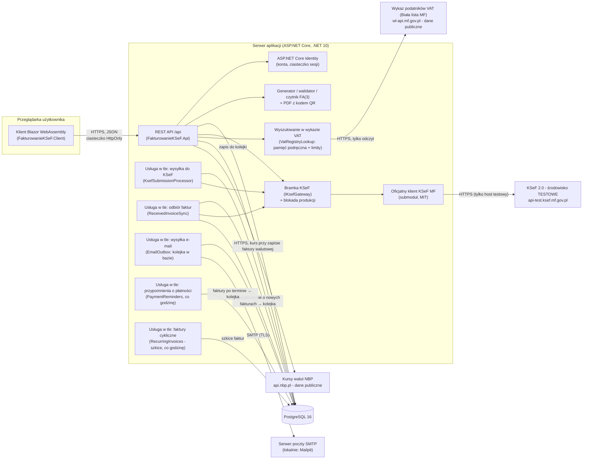
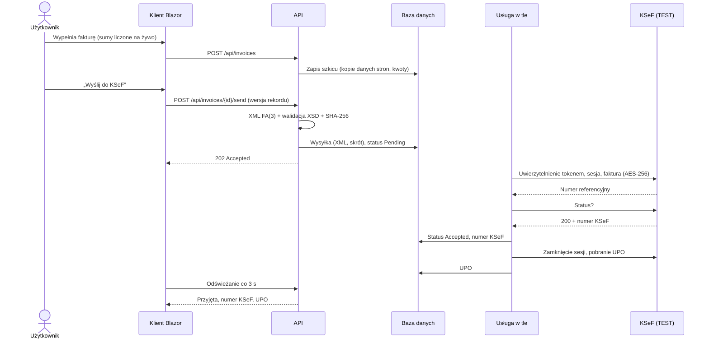

# Architektura systemu

## Charakterystyka

Fakturowanie KSeF to aplikacja webowa w modelu SaaS (D1): użytkownicy pracują w przeglądarce, a cała logika,
dane i integracja z Krajowym Systemem e-Faktur działają na serwerze. Aplikacja umożliwia:
- prowadzenie danych firmy i kontrahentów,
- wystawianie faktur VAT w strukturze FA(3),
- wysyłkę faktur do KSeF i odbiór numeru KSeF oraz UPO,
- pobieranie faktur zakupowych z KSeF,
- wizualizację faktur w PDF z kodem QR weryfikacji.

Integracja dotyczy wyłącznie środowiska testowego KSeF (D8).

## Widok komponentów

## Projekty (warstwy)

| Projekt | Odpowiedzialność | Zależności |
|---|---|---|
| `FakturowanieKSeF.Client` | Interfejs użytkownika (Blazor WebAssembly): strony, formularze z walidacją, komunikacja z API | `Contracts` |
| `FakturowanieKSeF.Contracts` | Kontrakt API współdzielony z klientem: DTO, enumy (stawki VAT FA(3), formy płatności, statusy), reguły walidacji, kalkulator kwot faktury | brak (czysty .NET) |
| `FakturowanieKSeF.Api` | Endpointy REST, uwierzytelnianie, izolacja danych, logika biznesowa (numeracja, statusy), usługi w tle, PDF, dostęp do bazy (EF Core), serwowanie klienta | `Models`, `Ksef`, `Contracts` |
| `FakturowanieKSeF.Models` | Encje domenowe i ich mapowanie (EF Core) | `Contracts` |
| `FakturowanieKSeF.Ksef` | Integracja z KSeF: bramka `IKsefGateway`, blokada produkcji, generator, walidator i czytnik XML FA(3), kod QR | `Models`, klient MF |
| `external/ksef-client-csharp` | Oficjalny klient KSeF Ministerstwa Finansów: protokół, kryptografia, podpis XAdES | - |
| `FakturowanieKSeF.Tests` | Testy jednostkowe, integracyjne (PostgreSQL), E2E (Playwright), testy na żywo z testowym KSeF | wszystkie |
| `tools/FakturowanieKSeF.KsefSpike` | Prototyp z etapu 1 (pełny przepływ KSeF w konsoli) | `Ksef` |

Klient przeglądarkowy zależy tylko od `Contracts`, więc encje bazy i EF Core nie trafiają do przeglądarki (D13).
Ten sam kalkulator kwot i te same reguły walidacji działają w przeglądarce i na serwerze.

## Kluczowe przepływy

### Obsługa żądania użytkownika

1. Przeglądarka wysyła żądanie JSON do `/api/...` z ciasteczkiem sesji (`HttpOnly`, `SameSite=Strict`).
2. Identity uwierzytelnia użytkownika. `CurrentCompany` ustala jego firmę, która jest jedynym źródłem
   `CompanyId` w zapytaniach (D15).
3. Walidacja DTO (atrybuty DataAnnotations, D14). Błędy wracają jako `ValidationProblemDetails` z polami.
4. Logika endpointu i EF Core (PostgreSQL). Konflikty, np. duplikat albo nieaktualna wersja, dają odpowiedź 409.

### Wystawienie i wysyłka faktury

Szczegóły: [`integracja-ksef.md`](integracja-ksef.md).

## Stos technologiczny

| Obszar | Technologia | Uzasadnienie |
|---|---|---|
| Platforma | .NET 10 (LTS, wsparcie do 11.2028) | D2, D9 |
| Backend | ASP.NET Core minimal API, walidacja wbudowana w .NET 10 | D14 |
| Frontend | Blazor WebAssembly (C# w przeglądarce), Bootstrap 5.3 z własnym design systemem (zmienne CSS, tryb ciemny, czcionka Inter) | D2, D13, D50 |
| Baza danych | PostgreSQL 16, EF Core 10 (Npgsql) | D2, D12 |
| Uwierzytelnianie | ASP.NET Core Identity, ciasteczko sesji / tokeny Bearer | D3, D18 |
| Szyfrowanie sekretów | ASP.NET Core Data Protection | D23 |
| KSeF | Oficjalny klient MF (`CIRFMF/ksef-client-csharp` 2.9.0) | D10 |
| XML FA(3) | `XmlWriter` + walidacja XSD (oficjalne schematy MF) | D21 |
| PDF / QR | QuestPDF, QRCoder | D27 |
| Dane kontrahentów | API wykazu podatników VAT MF (Biała lista), `IMemoryCache` | D28 |
| Poczta | MailKit (SMTP), kolejka w PostgreSQL; lokalnie Mailpit | D36 |
| Kursy walut | API NBP (tabela A), `IMemoryCache` | D43 |
| Testy | xUnit, WebApplicationFactory, Playwright, PdfPig | D7, etap 10 |
| CI | GitHub Actions (build, testy, E2E w Chromium) | D7 |
| Środowisko uruchomieniowe | Docker Compose: obraz aplikacji, PostgreSQL, Caddy (HTTPS Let's Encrypt) - `docs/wdrozenie.md` | D48 |

## Wybrane wzorce i zasady

- **Jedno źródło prawdy dla dokumentów:** faktura w KSeF to wysłany XML. Wydruk PDF i podgląd faktur otrzymanych
  powstają z XML (D21, D27).
- **Niezmienność wystawionych dokumentów:** kopie danych stron na fakturze (D12), brak edycji po wysyłce,
  miękkie usuwanie i `ON DELETE RESTRICT`.
- **Trwała maszyna stanów dla operacji asynchronicznych:** wysyłka i odbiór faktur odporne na restart
  i błędy sieci, z ochroną przed duplikatami (D25, D26); poczta wysyłana z kolejki w bazie z ponawianiem (D36).
- **Optymistyczna kontrola współbieżności:** wersja rekordu (`xmin`) chroni przed nadpisaniem zmian i podwójną
  wysyłką (D17).
- **Obrona wielowarstwowa:** izolacja danych w każdym zapytaniu, blokada produkcyjnego KSeF na trzech poziomach,
  walidacja w przeglądarce i na serwerze.
- **Bramka (adapter) do systemu zewnętrznego:** `IKsefGateway` oddziela logikę aplikacji od protokołu KSeF
  i umożliwia testy bez sieci.
