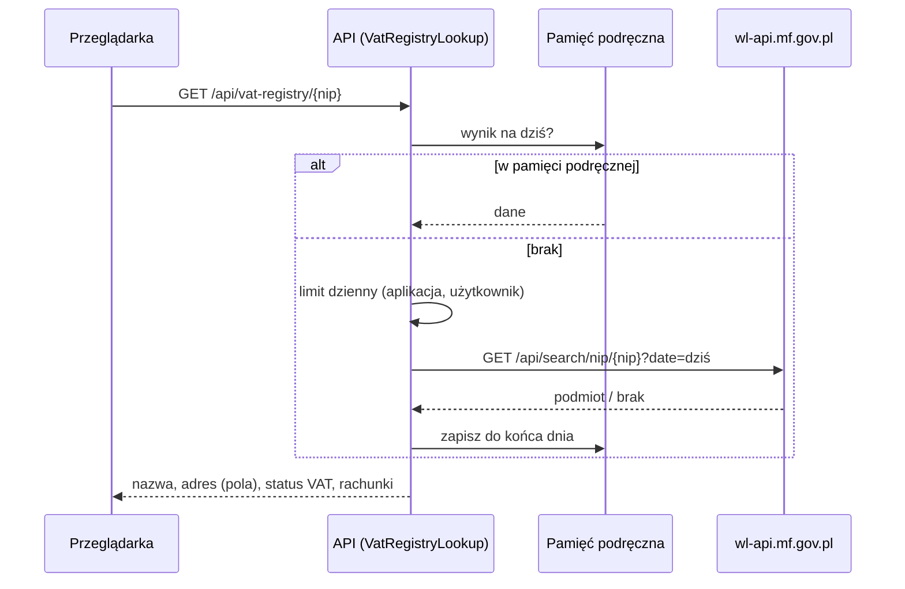

# Funkcje dodatkowe (rozwój po MVP)

Po zrealizowaniu MVP przeanalizowano funkcje popularnych programów do fakturowania z obsługą KSeF dla małych firm
(inFakt, Fakturownia, wFirma, iFirma, Fakturowo, Comarch ERP Optima). Na tej podstawie powstała lista funkcji
dodatkowych z priorytetami. Każda funkcja jest realizowana na osobnej gałęzi i scalana osobnym pull requestem.

## Analiza rozwiązań konkurencyjnych

Funkcje występujące u większości konkurentów, a nieobecne w MVP:
- uzupełnianie danych kontrahenta po NIP (wykaz podatników VAT lub REGON),
- weryfikacja rachunku kontrahenta na białej liście (KSeF tego nie sprawdza),
- status płatności faktur (opłacona / nieopłacona / po terminie),
- kopiowanie faktury („wystaw podobną”),
- faktury korygujące,
- wysyłka faktury e-mailem, przypomnienia o płatności, faktury cykliczne, płatności online,
- aplikacja mobilna, powiadomienia o nowych fakturach kosztowych.

**Obserwacja:** konkurenci oferują rozpoznawanie faktur kosztowych ze zdjęć (OCR). Przy KSeF faktury krajowe
przychodzą jako ustrukturyzowany XML, więc OCR traci znaczenie - aplikacja odczytuje dane wprost ze struktury FA(3).

## Lista funkcji i stan realizacji

| # | Funkcja | Priorytet | Stan |
|---|---|---|---|
| 1 | Dane kontrahenta z wykazu podatników VAT po NIP (D28) | wysoki | ✅ |
| 2 | Weryfikacja rachunku na białej liście (faktury otrzymane) | wysoki | w realizacji |
| 3 | Status płatności faktur wystawionych i otrzymanych | wysoki | planowana |
| 4 | „Wystaw podobną” - kopia faktury jako nowy szkic | wysoki | planowana |
| 5 | Faktury korygujące | wysoki | planowana |
| 6 | Wysyłka faktury e-mailem | średni | do decyzji |
| 7 | Faktury cykliczne | średni | do decyzji |
| 8 | Przypomnienia o płatności | średni | do decyzji |
| 9 | Powiadomienie o nowej fakturze kosztowej | średni | do decyzji |
| 10 | Pulpit z wykresami | średni | do decyzji |
| 11 | Katalog produktów i usług | niski | do decyzji |
| 12 | Waluty obce z kursem NBP | niski | do decyzji |
| 13 | Eksport dla księgowej (CSV, paczka XML + UPO) | niski | do decyzji |
| 14 | Aplikacja mobilna (PWA) | niski | do decyzji |
| 15 | Logowanie dwuskładnikowe | niski | do decyzji |
| 16 | Faktura proforma | niski | do decyzji |
| 17 | Tryb offline KSeF (kod QR II) | badawczy | do decyzji |
| 18 | Dostęp księgowej do firmy (role) | badawczy | do decyzji |
| 19 | Import faktur sprzedażowych wystawionych poza aplikacją | badawczy | do decyzji |

## 1. Dane kontrahenta z wykazu podatników VAT

Przycisk **Pobierz z wykazu VAT** przy polu NIP (kontrahent, nabywca na fakturze, dane firmy) uzupełnia nazwę
i adres na podstawie wykazu podatników VAT MF. Szczegóły i uzasadnienie: decyzja D28.

Źródła analizy: strony producentów i porównania z 2026 r. (iFirma - przegląd programów do obsługi KSeF,
Bezprawnik - ranking programów do faktur z KSeF, strony funkcji Fakturowni, inFaktu i wFirmy).
