# Instrukcja użytkownika

Aplikacja Fakturowanie KSeF służy do wystawiania faktur VAT, wysyłania ich do Krajowego Systemu e-Faktur (KSeF)
i odbierania faktur od kontrahentów. **Wersja testowa** komunikuje się wyłącznie ze środowiskiem testowym KSeF:
faktury nie mają mocy prawnej. Używaj wyłącznie danych fikcyjnych.

## 1. Konto

**Rejestracja.** Wybierz „Zarejestruj się”, podaj e-mail i hasło. Hasło musi mieć co najmniej 8 znaków,
w tym wielką i małą literę, cyfrę oraz znak specjalny. Po rejestracji zostaniesz zalogowany i przeniesiony
do danych firmy.

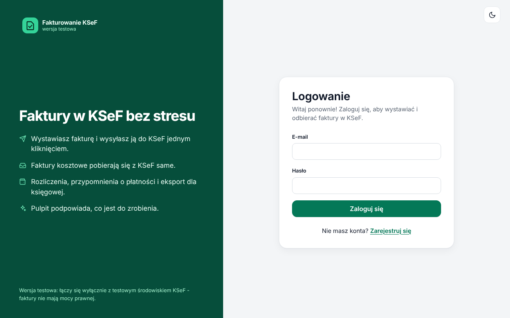

**Logowanie i wylogowanie.** Sesja trwa 8 godzin i wydłuża się przy aktywności. Po 5 nieudanych próbach logowania
konto jest blokowane na 15 minut. Przycisk „Wyloguj” znajduje się w prawym górnym rogu.

### Logowanie dwuskładnikowe

Kliknij swój adres e-mail w górnym pasku, aby otworzyć stronę **Bezpieczeństwo konta**. Wybierz **Włącz logowanie
dwuskładnikowe**, zeskanuj kod QR w aplikacji uwierzytelniającej (np. Google Authenticator, Microsoft Authenticator)
i wpisz pokazany przez nią 6-cyfrowy kod. Zapisz 10 kodów odzyskiwania - każdy pozwala zalogować się raz, gdy nie masz
dostępu do telefonu. Od tej pory po wpisaniu hasła aplikacja poprosi o kod z telefonu. Wyłączenie zabezpieczenia
i wygenerowanie nowych kodów odzyskiwania wymagają podania kodu.

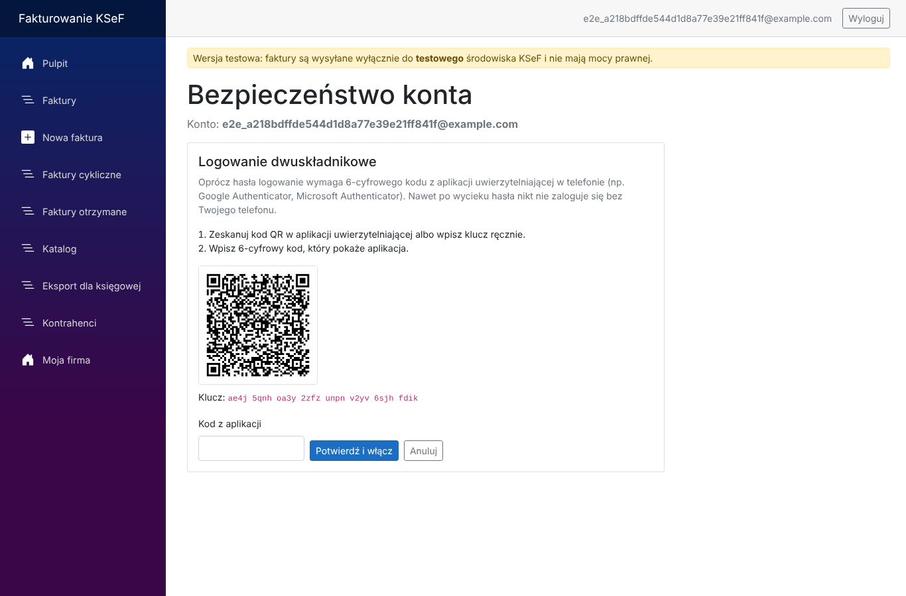

## 2. Moja firma i integracja z KSeF

W menu **Moja firma** uzupełnij dane, które pojawią się jako sprzedawca na fakturach: nazwę, NIP, adres
i rachunek bankowy. Rachunek będzie podpowiadany na fakturach płatnych przelewem.

W sekcji **Integracja z KSeF** skonfiguruj token, bez którego nie można wysyłać ani odbierać faktur:
- **Zapisz token**: wklej token wygenerowany w Aplikacji Podatnika KSeF. Aplikacja sprawdzi go w KSeF przed zapisaniem.
- **Wygeneruj token testowy**: aplikacja sama utworzy token w testowym KSeF dla NIP-u firmy.

Token jest przechowywany w postaci zaszyfrowanej i nie jest nigdy wyświetlany.

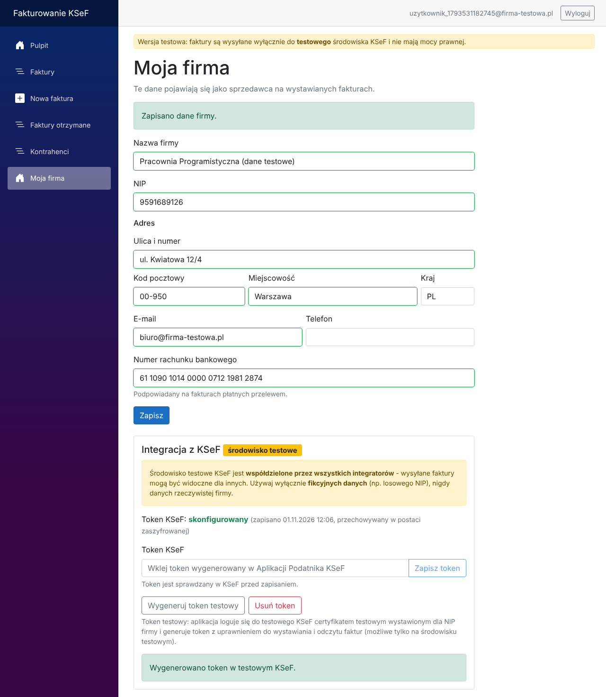

## 3. Kontrahenci

W menu **Kontrahenci** możesz prowadzić książkę adresową nabywców: firmy z NIP-em lub osoby prywatne.
Wyszukiwanie działa po nazwie i NIP. Zmiana danych kontrahenta nie zmienia faktur już wystawionych.

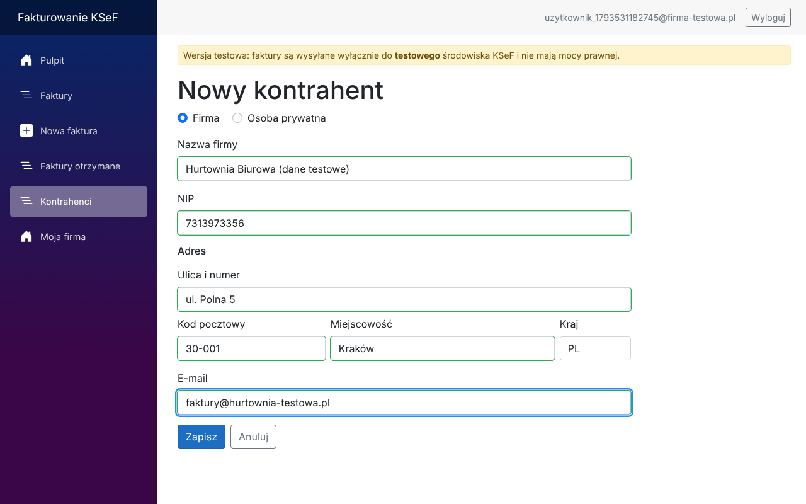

**Dane z wykazu podatników VAT.** Wpisz NIP i wybierz **Pobierz z wykazu VAT**: nazwa i adres uzupełnią się
na podstawie wykazu Ministerstwa Finansów (tzw. Biała lista). Pod polem pojawi się data stanu danych i status VAT,
a ostrzeżenie, jeśli podmiot nie jest czynnym podatnikiem VAT. Ten sam przycisk działa przy NIP-ie nabywcy
wpisywanym ręcznie na fakturze i w danych Twojej firmy (tam podpowiada też rachunek bankowy). Dzienna liczba
sprawdzeń jest ograniczona; po jej wyczerpaniu dane można wpisać ręcznie.

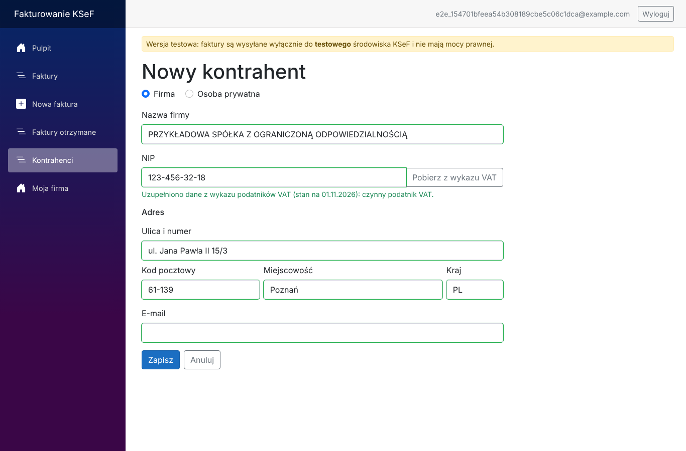

**Katalog towarów i usług.** W menu **Katalog** zapisz towary i usługi, które często sprzedajesz: nazwę,
jednostkę, cenę netto i stawkę VAT. Na fakturze pole nazwy pozycji podpowiada nazwy z katalogu, a po wybraniu jednej
z nich jednostka, cena i stawka uzupełnią się same (możesz je zmienić). Pozycję wpisaną na fakturze, której nie ma
w katalogu, dodasz przyciskiem **zapisz w katalogu** pod jej nazwą. Zmiana lub usunięcie pozycji katalogu nie zmienia
wystawionych faktur.

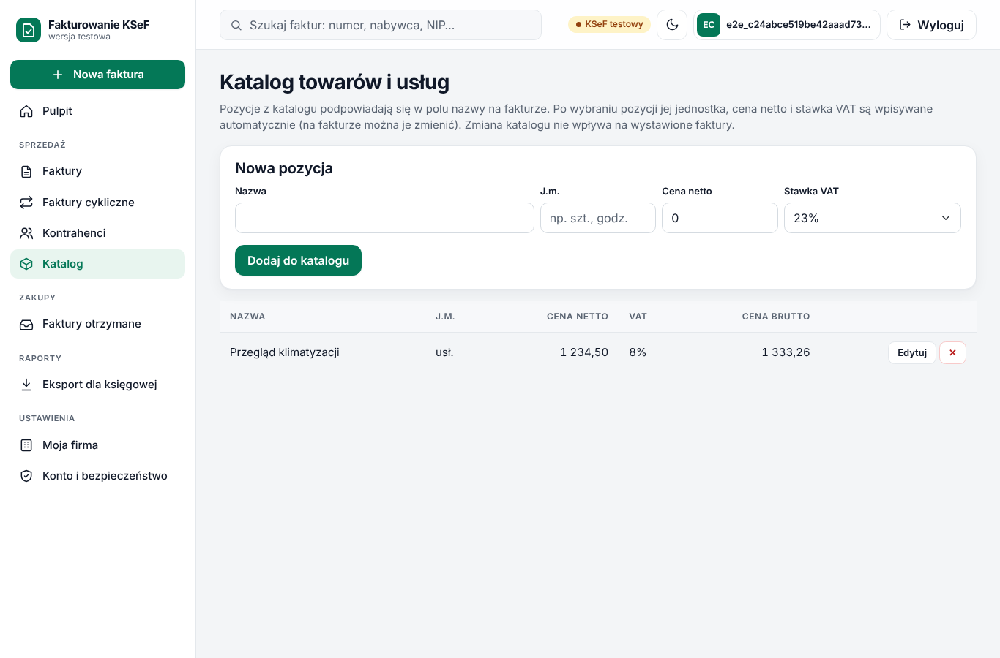

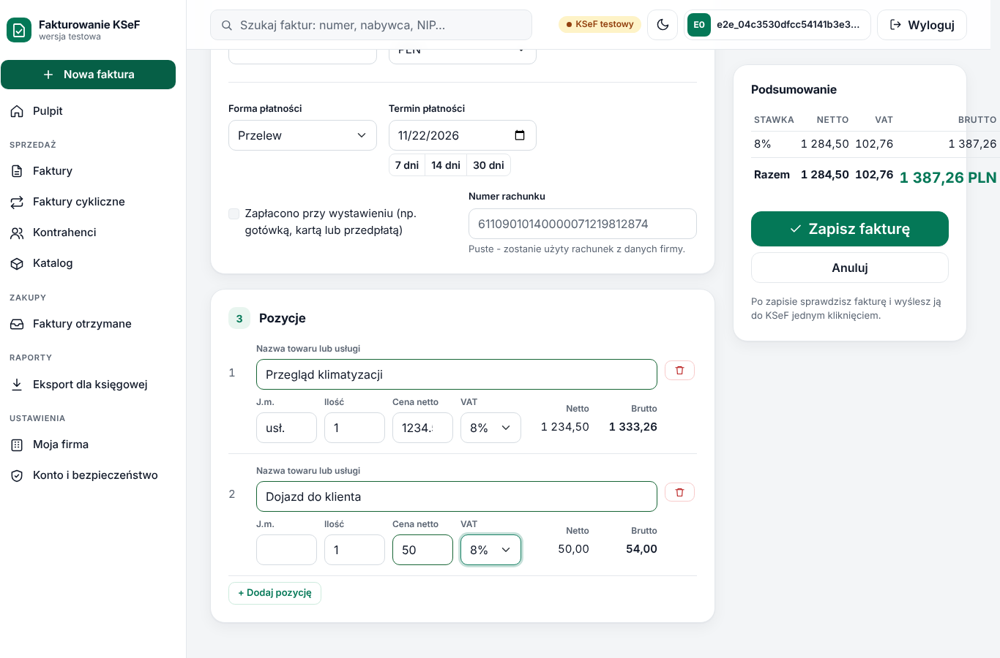

## 4. Wystawianie faktury

Wybierz **Nowa faktura**:
1. **Numer**: zostaw puste pole, a aplikacja nada kolejny numer (np. `FV/1/11/2026`). Możesz też wpisać własny.
2. **Daty**: data wystawienia oraz data sprzedaży, jeśli jest inna.
3. **Nabywca**: wybierz kontrahenta z listy albo wpisz dane ręcznie.
4. **Pozycje**: nazwa, jednostka, ilość, cena netto i stawka VAT. Wartości i podsumowanie według stawek liczą się
   na bieżąco. Przy stawce „zw” podaj podstawę prawną zwolnienia.
5. **Płatność**: forma, termin (przyciski 7, 14 lub 30 dni) i rachunek.
6. **Zapisz fakturę**. Faktura zostaje zapisana jako **szkic**, który możesz jeszcze edytować lub usunąć.

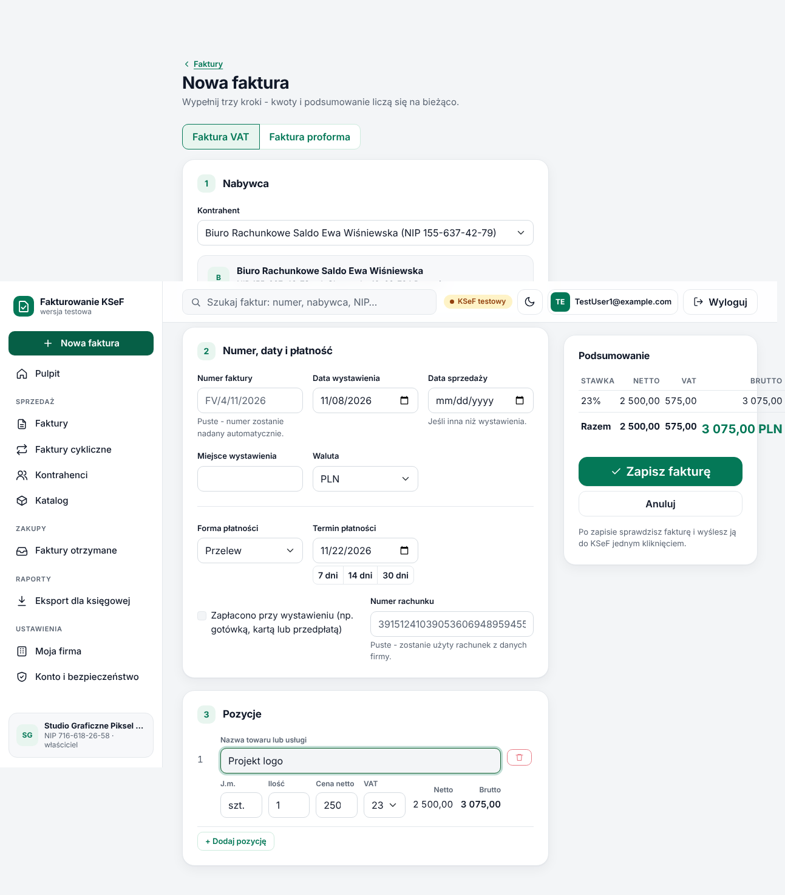

**Wystaw podobną.** W podglądzie dowolnej faktury przycisk **Wystaw podobną** otwiera formularz nowej faktury
wypełniony danymi wzoru: nabywcą, pozycjami, podstawą zwolnienia i warunkami płatności. Numer zostanie nadany
nowy, data wystawienia to dzisiaj, a termin płatności zachowuje ten sam odstęp dni co we wzorze. Przydaje się przy
fakturach powtarzalnych, np. comiesięcznym abonamencie. Nic nie jest zapisywane, dopóki nie wybierzesz
**Zapisz fakturę**.

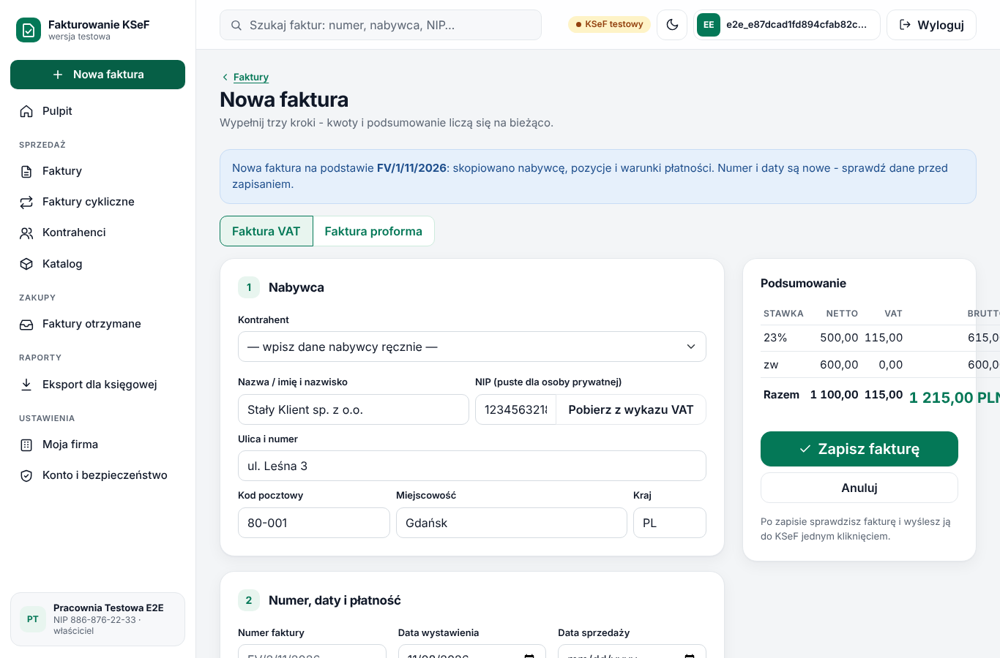

### Faktury cykliczne

Jeśli co miesiąc (kwartał, rok) wystawiasz tę samą fakturę, otwórz ją i wybierz **Ustaw jako cykliczną**. Podaj okres,
datę pierwszego wystawienia i opcjonalnie datę końcową. W wyznaczonym dniu aplikacja przygotuje **szkic** na wzór tej
faktury: z aktualnymi danymi kontrahenta, nowym numerem, dzisiejszą datą wystawienia i terminem płatności z tym samym
odstępem. Szkic nie jest wysyłany do KSeF automatycznie - sprawdź go (np. cenę) i wyślij. Harmonogramy znajdziesz
w menu **Faktury cykliczne**; możesz je wstrzymać, zmienić lub usunąć (faktury już utworzone pozostają).

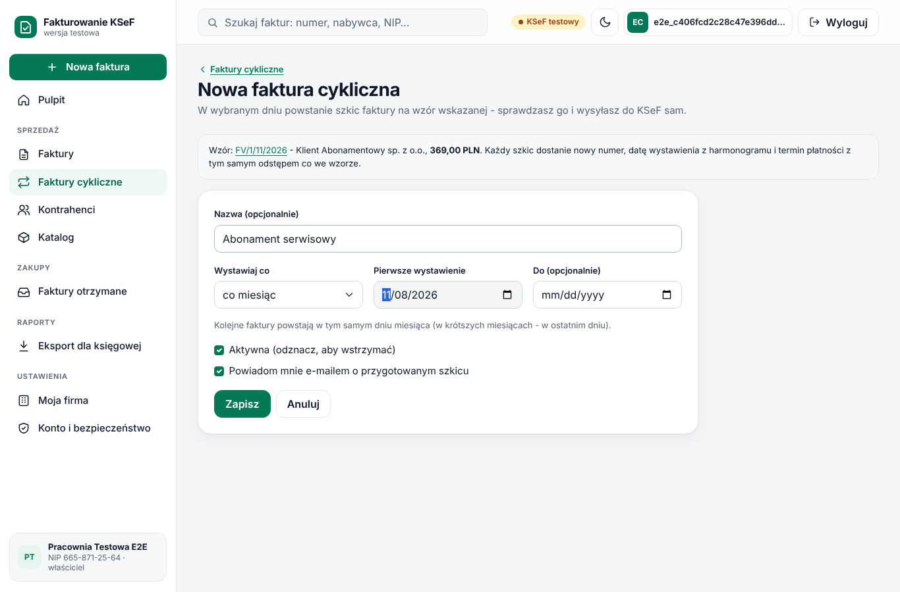

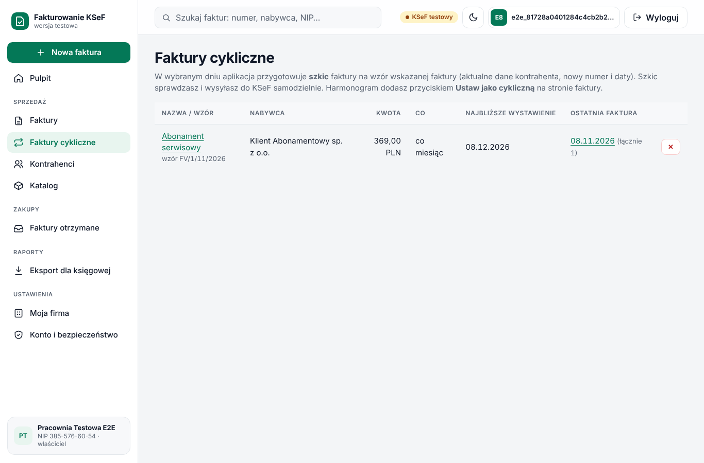

## 5. Wysyłka do KSeF

W podglądzie szkicu wybierz **Wyślij do KSeF** i potwierdź. Faktura otrzyma status „Wysłana do KSeF”,
a strona będzie odświeżać się automatycznie.

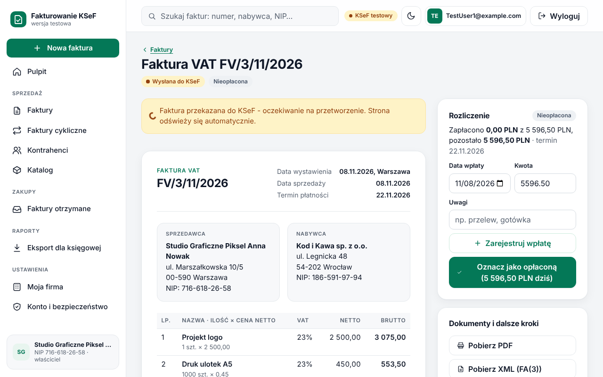

Po kilku sekundach KSeF nada fakturze **numer KSeF**, a status zmieni się na „Przyjęta w KSeF”. Od tej chwili
faktura jest dokumentem ostatecznym i nie można jej zmienić. Dostępne są przyciski:
- **Pobierz UPO**: urzędowe poświadczenie odbioru faktury przez KSeF,
- **Pobierz PDF**: wydruk faktury z kodem QR weryfikacji,
- **Pobierz XML (FA(3))**: faktura w postaci przesłanej do KSeF.

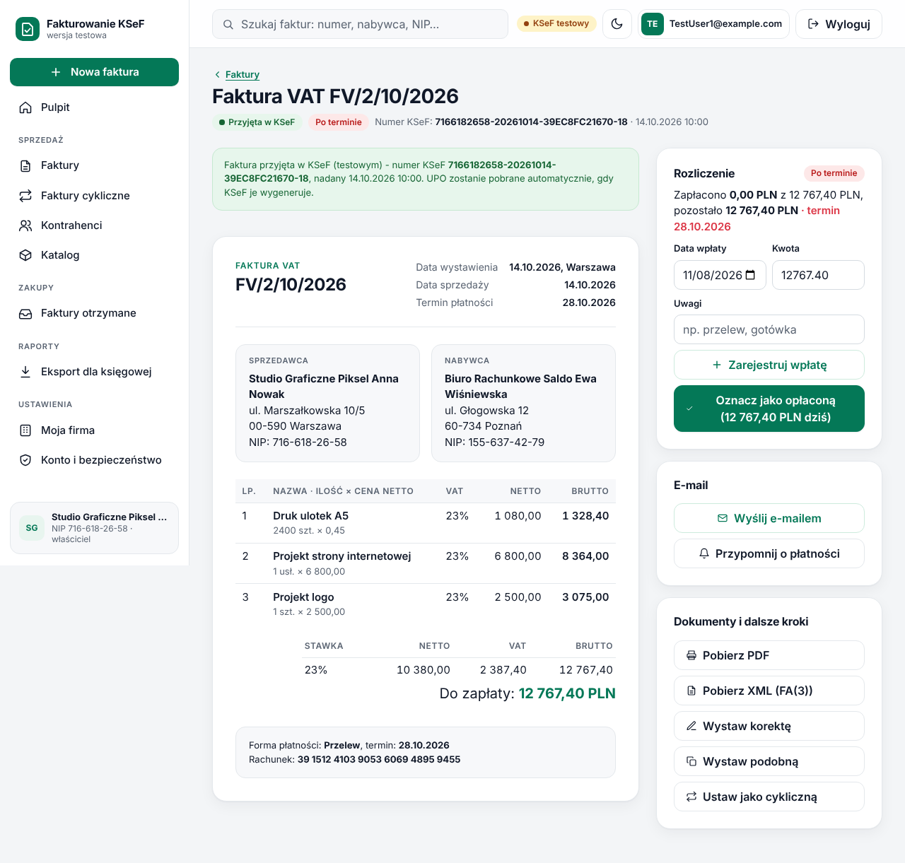

Jeśli KSeF **odrzuci** fakturę, zobaczysz kod błędu i jego opis. Popraw fakturę („Edytuj”) i wyślij ją ponownie.

**Faktura korygująca.** Jeśli faktura przyjęta w KSeF zawiera błąd albo udzielasz rabatu lub przyjmujesz zwrot,
wybierz w jej podglądzie **Wystaw korektę**. Formularz pokazuje stan przed korektą i pozycje do zmiany: popraw
cenę, ilość lub stawkę, dodaj albo usuń pozycje (usunięcie wszystkich oznacza korektę do zera). Podaj przyczynę
korekty. Na bieżąco widać różnicę. Korekta dostaje numer z serii `KOR/…` i wysyłasz ją do KSeF jak zwykłą
fakturę. Na fakturze korygowanej pojawia się lista korekt, a kwota do zapłaty w rozliczeniu uwzględnia korekty
(po obniżce kwoty już opłaconej faktury aplikacja pokaże nadpłatę do zwrotu). Kolejną korektę tej samej faktury
wystawisz po przyjęciu poprzedniej przez KSeF.

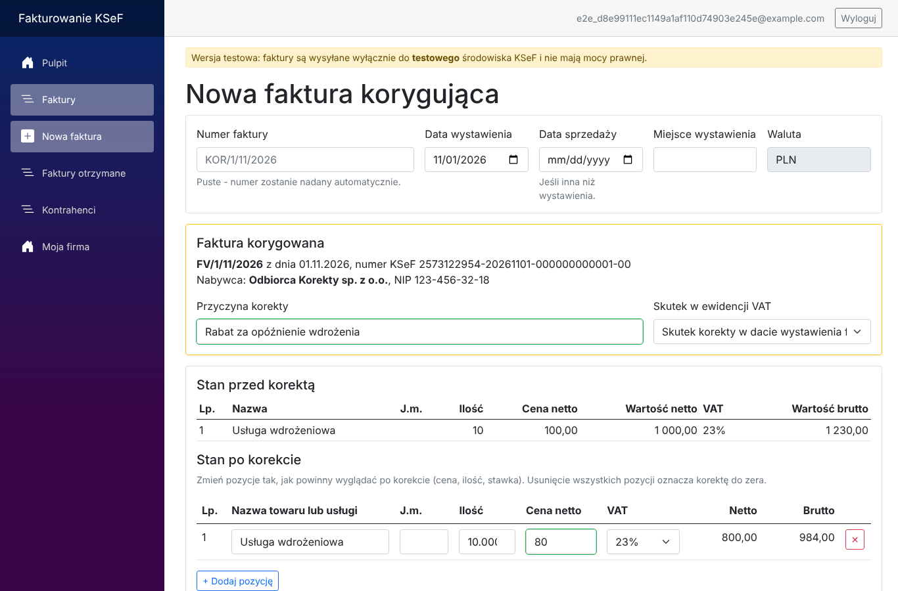

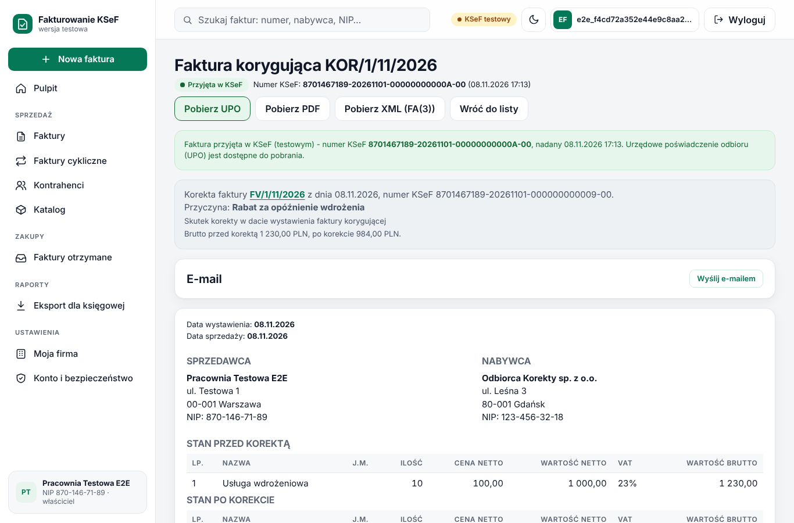

### Wysyłka faktury e-mailem

Fakturę przyjętą w KSeF wyślesz nabywcy przyciskiem **Wyślij e-mailem** w sekcji **E-mail**. Adres podpowiada się
z danych kontrahenta. Możesz dopisać krótką wiadomość. W załączniku nabywca dostanie PDF z kodem QR i plik XML faktury.
Odpowiedzi trafią na adres e-mail Twojej firmy. Wiadomość jest wysyłana w tle - stan (*w kolejce*, *wysłano*,
*błąd wysyłki*) widać w historii pod formularzem. Przy chwilowej awarii serwera poczty aplikacja ponawia wysyłkę.

W wersji deweloperskiej wiadomości nie trafiają do prawdziwych odbiorców - przechwytuje je skrzynka testowa
Mailpit (http://localhost:8025).

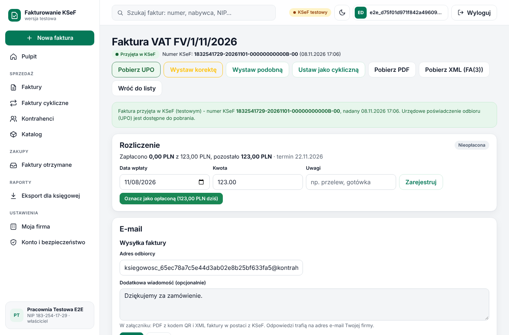

## 6. Wydruk (PDF) i kod QR

PDF zawiera kod QR weryfikacji z numerem KSeF pod spodem. Odbiorca, który dostał fakturę poza KSeF
(e-mailem, w wydruku), może zeskanować kod, żeby sprawdzić, czy faktura znajduje się w KSeF, i pobrać jej XML.
PDF szkicu jest oznaczony jako dokument niebędący fakturą.

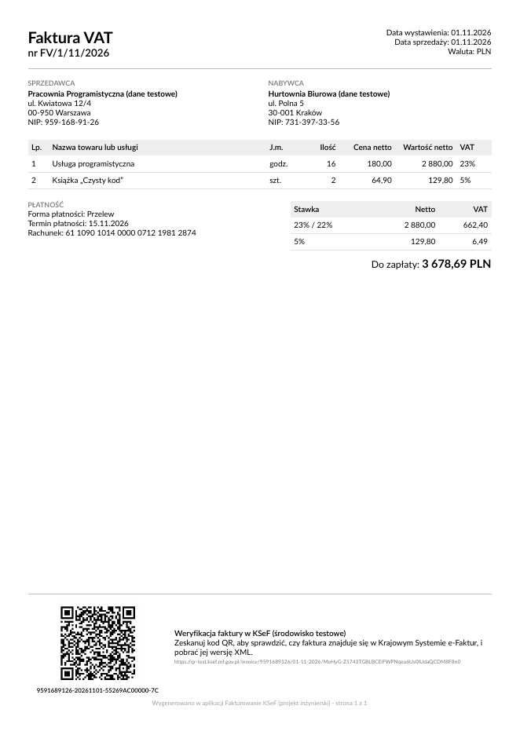

## 7. Rozliczenia (płatności)

Pod danymi faktury przekazanej do KSeF znajduje się sekcja **Rozliczenie**. Rejestruj w niej wpłaty od nabywcy:
datę, kwotę (domyślnie pozostała do zapłaty) i uwagi, np. „zaliczka”. Aplikacja pokazuje stan: *Nieopłacona*,
*Częściowo opłacona*, *Opłacona* lub *Po terminie*. Przycisk **Oznacz jako opłaconą** rejestruje wpłatę pozostałej
kwoty z dzisiejszą datą. Błędnie zarejestrowaną wpłatę usuniesz przyciskiem ✕. Tak samo rejestrujesz zapłaty za
faktury otrzymane. Szkice i faktury odrzucone nie podlegają rozliczeniu.

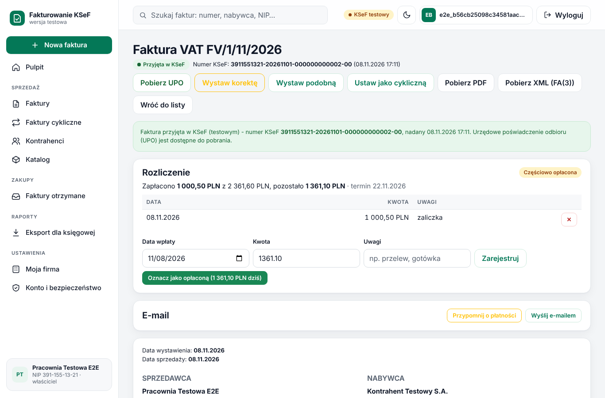

Jeśli nabywca zapłacił od razu (gotówką, kartą, przedpłatą), zaznacz w formularzu faktury **Zapłacono przy
wystawieniu** i podaj datę zapłaty (nie późniejszą niż data wystawienia). Termin płatności nie jest wtedy potrzebny.
Informacja o zapłacie trafi do KSeF razem z fakturą, a po wysyłce faktura od razu jest *Opłacona*. Tej wpłaty nie
można usunąć, bo jest zapisana w fakturze w KSeF (oznaczenie „w fakturze”).

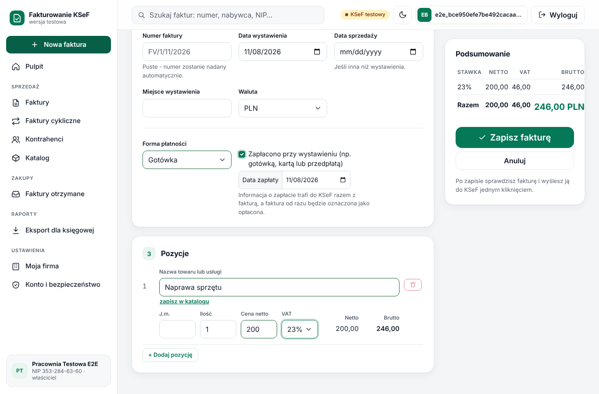

**Przypomnienia o płatności.** Przy fakturze z kwotą do zapłaty w sekcji **E-mail** jest przycisk
**Przypomnij o płatności**. Nabywca dostanie wiadomość z kwotą pozostałą do zapłaty, terminem, numerem rachunku
i fakturą w załączniku. Na stronie **Moja firma** w sekcji **Powiadomienia e-mail** możesz włączyć przypomnienia
automatyczne: pierwsze po wybranej liczbie dni od terminu, kolejne co 7 dni, najwyżej 3 do jednej faktury. Trafiają
na adres e-mail kontrahenta (albo na adres, na który wysłano fakturę) i ustają po zarejestrowaniu pełnej wpłaty.

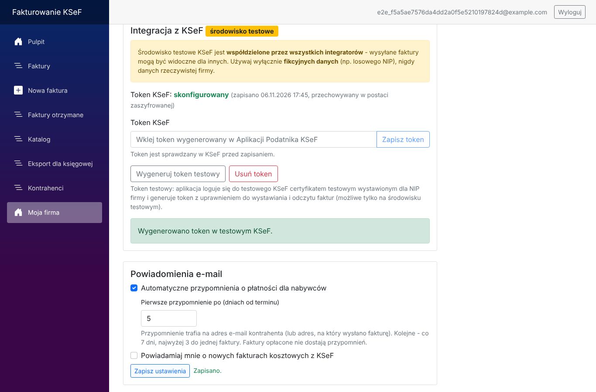

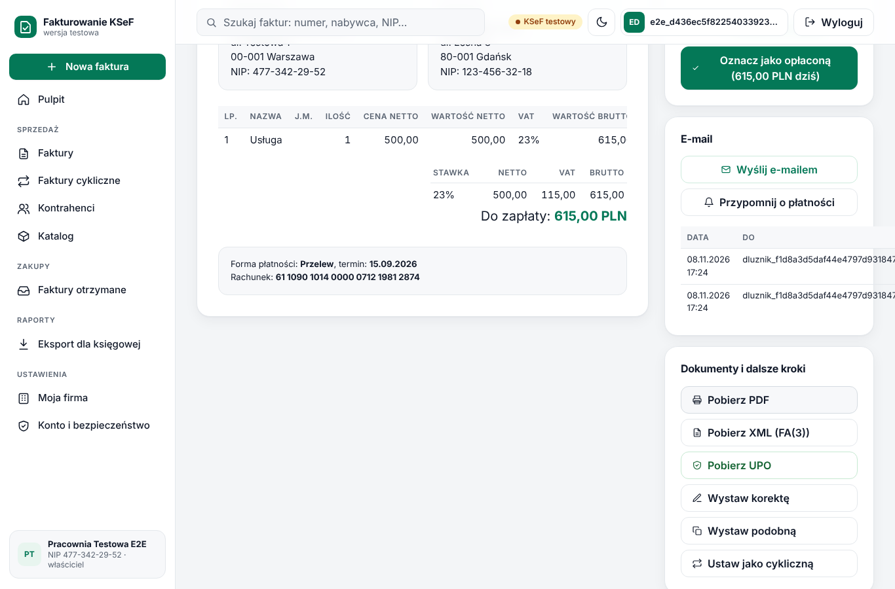

Listy faktur mają filtr **Płatność** (nieopłacone, po terminie, opłacone), a pulpit pokazuje sumę **należności**
i **zobowiązań**, w tym kwoty po terminie. Kliknięcie kwoty otwiera listę odpowiednich faktur.

## 8. Lista faktur i pulpit

W menu **Faktury** jest lista faktur z wyszukiwaniem (numer, nabywca, NIP, numer KSeF), filtrami statusu i dat
oraz stronicowaniem. **Pulpit** pokazuje liczbę faktur w każdym statusie.

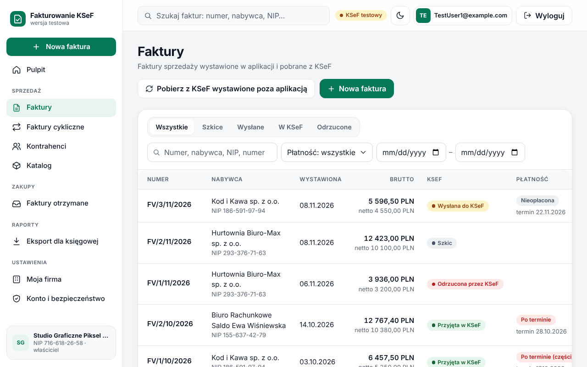

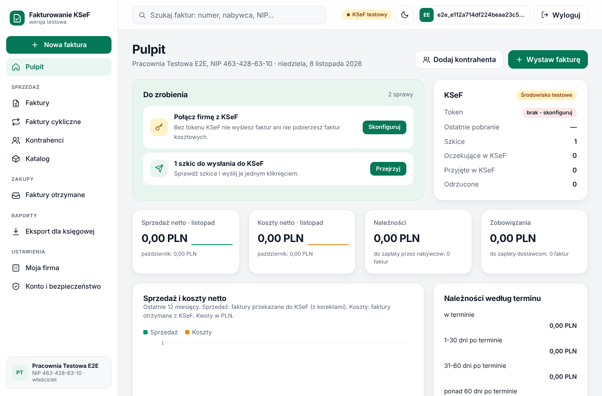

### Wykresy na pulpicie

Pod podsumowaniem należności pulpit pokazuje wykres sprzedaży i kosztów netto w ostatnich 12 miesiącach,
należności według liczby dni po terminie oraz największych nabywców (kliknięcie nazwy otwiera ich faktury).
Po najechaniu na kolumnę widać dokładną kwotę, a wszystkie wartości są w tabeli **Dane w tabeli** pod wykresem.

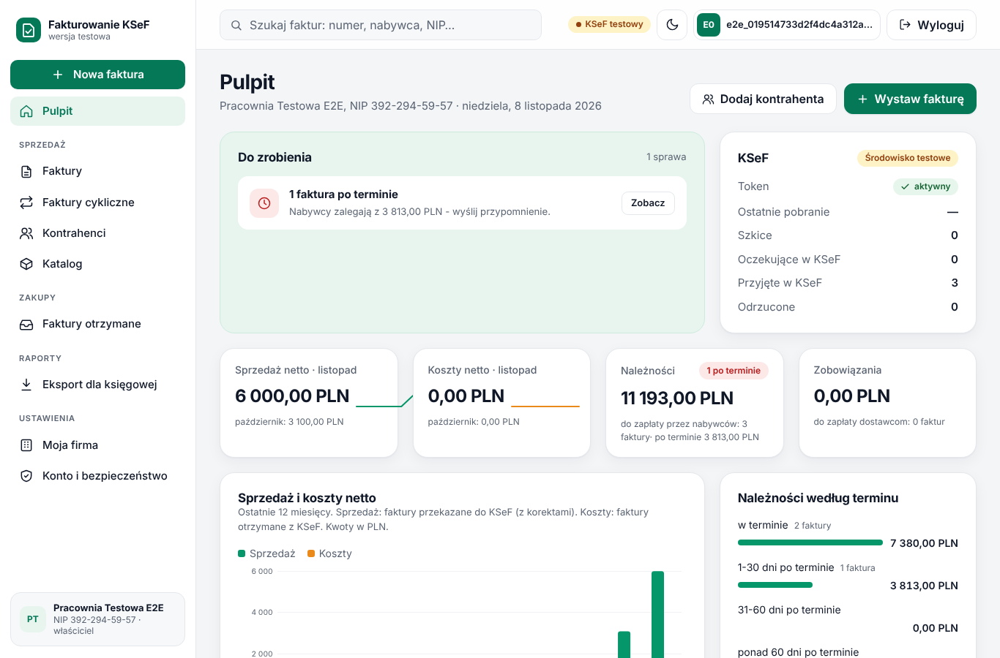

## 9. Faktury otrzymane

W menu **Faktury otrzymane** znajdują się faktury wystawione na NIP Twojej firmy przez innych podatników,
pobrane z KSeF. Aplikacja pobiera je automatycznie co 15 minut. Możesz też wybrać **Pobierz z KSeF**,
nie częściej niż raz na minutę. Nowa faktura jest dostępna do pobrania zwykle kilka minut po jej wystawieniu.

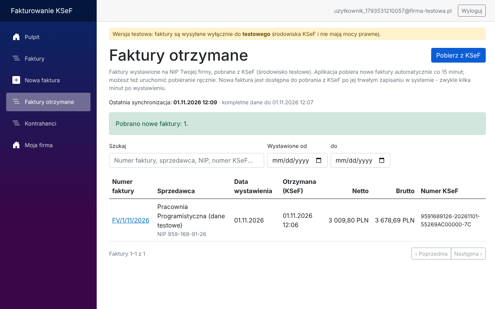

Podgląd faktury otrzymanej pokazuje jej pełną treść, a także umożliwia pobranie XML i PDF z kodem QR.

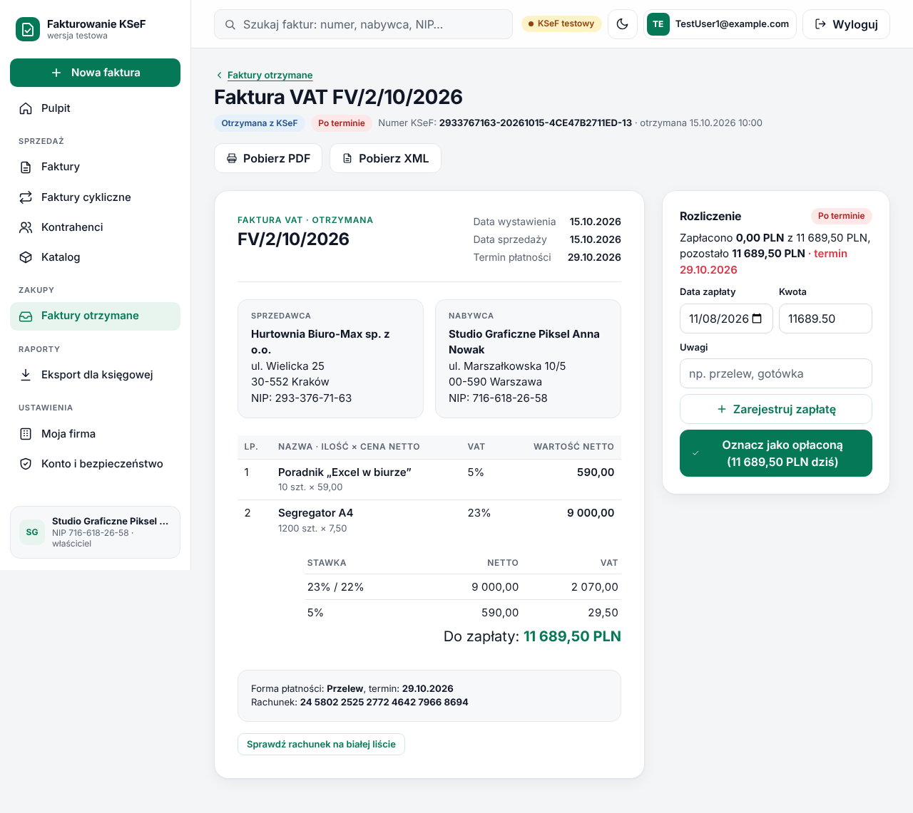

**Sprawdzenie rachunku na białej liście.** Przed zapłatą wybierz **Sprawdź rachunek na białej liście** pod danymi
płatności. Aplikacja sprawdzi w wykazie podatników VAT Ministerstwa Finansów, czy rachunek z faktury należy do
sprzedawcy, i zapisze wynik z datą oraz identyfikatorem zapytania MF (warto go zachować jako potwierdzenie).
Przy kwotach powyżej 15 000 zł aplikacja przypomina o sprawdzeniu: zapłata na rachunek spoza wykazu pozbawia prawa
do zaliczenia wydatku do kosztów i grozi solidarną odpowiedzialnością za VAT sprzedawcy. Faktury z rachunkiem
spoza wykazu są oznaczone na liście czerwoną etykietą. Sprawdzenie dotyczy stanu wykazu na dany dzień, dlatego
najlepiej wykonać je w dniu zlecenia przelewu („Sprawdź ponownie”).

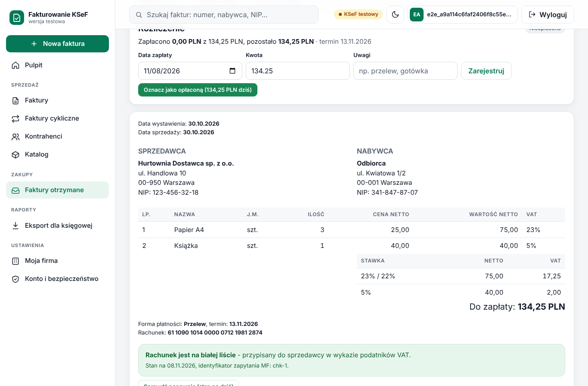

### Powiadomienia o nowych fakturach kosztowych

Na stronie **Moja firma** w sekcji **Powiadomienia e-mail** zaznacz **Powiadamiaj mnie o nowych fakturach kosztowych
z KSeF**. Po każdym pobraniu nowych faktur z KSeF dostaniesz jedną wiadomość z ich listą: sprzedawca, kwota i termin
płatności. Przy fakturach powyżej 15 000 zł wiadomość przypomni o sprawdzeniu rachunku sprzedawcy na białej liście.
Adres powiadomień możesz zmienić; puste pole oznacza adres Twojego konta.

## 10. Eksport dla księgowej

W menu **Eksport dla księgowej** wybierz miesiąc (domyślnie poprzedni) albo dowolny okres (od-do). Aplikacja pokaże
liczbę i kwoty faktur sprzedaży (przyjętych w KSeF, według daty wystawienia) i zakupu (według daty otrzymania w KSeF).
Do pobrania są:
- **Zestawienie sprzedaży (CSV)** i **Zestawienie zakupów (CSV)** - otwierają się w Excelu; kwoty netto i VAT
  w kolumnach według stawek,
- **Paczka ZIP** - oba zestawienia oraz pliki XML faktur (w postaci z KSeF) i UPO faktur sprzedaży.

Przed eksportem zakupów zsynchronizuj faktury otrzymane, żeby paczka zawierała najnowsze dokumenty.

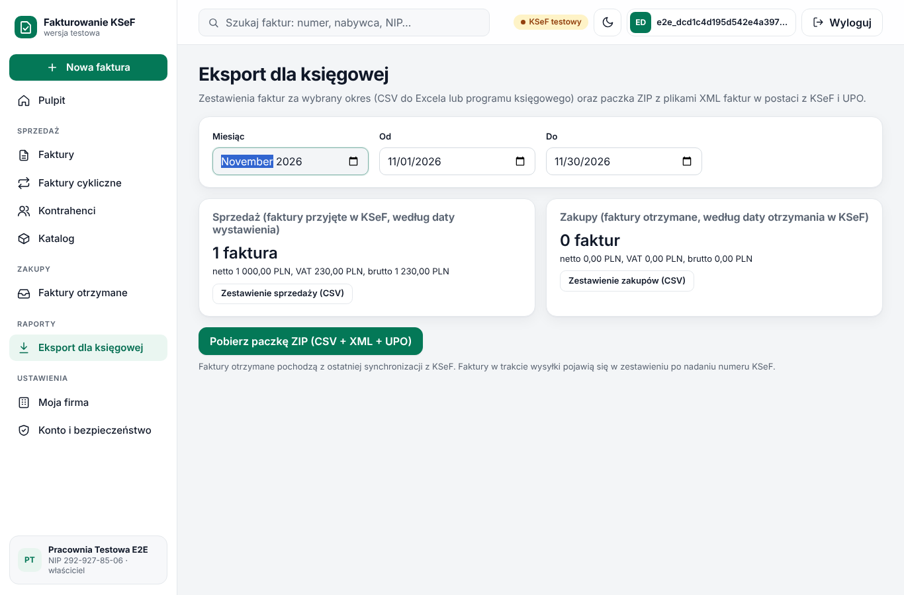

## Najczęstsze komunikaty

| Komunikat | Znaczenie i rozwiązanie |
|---|---|
| „Najpierw uzupełnij dane swojej firmy.” | Wypełnij formularz w menu Moja firma. |
| „Najpierw skonfiguruj token KSeF…” | Zapisz lub wygeneruj token w sekcji Integracja z KSeF. |
| „Dane zostały w międzyczasie zmienione…” | Faktura była edytowana w innym oknie. Odśwież stronę i powtórz zmianę. |
| „Faktura o tym numerze już istnieje.” | Zmień numer albo zostaw pole puste (numer automatyczny). |
| „Synchronizacja była uruchomiona przed chwilą…” | Odczekaj minutę przed ponownym pobraniem faktur otrzymanych. |
| „W obecnej wersji obsługiwane są wyłącznie faktury w PLN.” | Ograniczenie wersji MVP. |
| „Podmiotu o tym numerze NIP nie ma w wykazie podatników VAT.” | Podmiot nie jest zarejestrowany jako podatnik VAT (np. osoba prywatna). Wpisz dane ręcznie. |
| „Kwota przekracza pozostałą do zapłaty (…)” | Wpłata większa niż pozostała kwota. Sprawdź kwotę lub zarejestrowane wcześniej wpłaty. |
| „Wykorzystano dzienny limit sprawdzeń w wykazie…” | Wpisz dane ręcznie lub skorzystaj z wykazu następnego dnia. |
