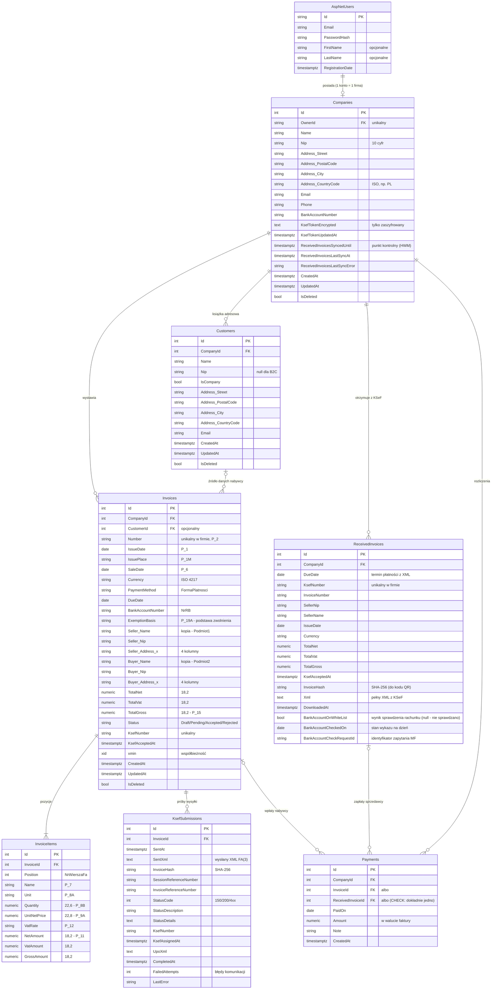

# Model danych

Baza PostgreSQL 16, mapowanie EF Core 10 (code-first, migracje w `FakturowanieKSeF.Api/Data/Migrations`).
Encje: `FakturowanieKSeF.Models`, konfiguracja relacji i indeksów: `FakturowanieKSeF.Api/Data/AppDbContext.cs`.

## Diagram ERD

Tabele ASP.NET Core Identity poza `AspNetUsers` (role, claimy, loginy zewnętrzne, tokeny) pominięto.
Kolumny typów własnych (adres, strony faktury) są w tabeli właściciela z prefiksem, np. `Buyer_Address_City`.

## Opis tabel

| Tabela | Rola |
|---|---|
| `AspNetUsers` | Konta użytkowników (ASP.NET Core Identity): e-mail, hash hasła, blokady konta. |
| `Companies` | Firma użytkownika: sprzedawca na fakturach sprzedażowych, nabywca na fakturach z KSeF. Zawiera zaszyfrowany token KSeF. |
| `Customers` | Książka adresowa kontrahentów firmy (B2B z NIP lub B2C bez NIP). |
| `Invoices` | Faktury sprzedażowe: nagłówek, kopie danych stron, sumy, status i numer KSeF. |
| `InvoiceItems` | Pozycje faktury (FaWiersz). |
| `KsefSubmissions` | Historia prób wysyłki faktury do KSeF: wysłany XML, skrót, numery referencyjne, status, numer KSeF, UPO. |
| `DataProtectionKeys` | Klucze ASP.NET Core Data Protection (szyfrowanie tokenów KSeF i ciasteczek sesji), rotowane automatycznie. |
| `Payments` | Rozliczenia: wpłaty za faktury wystawione i zapłaty za otrzymane (D30). Stan rozliczenia jest wyliczany z sumy płatności, a nie przechowywany. |
| `ReceivedInvoices` | Faktury zakupowe pobrane z KSeF (tylko do odczytu), z pełnym XML. Jedyne pola zmieniane przez użytkownika to wynik sprawdzenia rachunku na białej liście (D29). |

## Kluczowe reguły

**Niezmienność wystawionych faktur.** Dane sprzedawcy i nabywcy są kopiowane na fakturę w chwili wystawienia
(`Seller_*`, `Buyer_*`). Późniejsza zmiana danych firmy lub kontrahenta nie zmienia faktur już wystawionych.
`CustomerId` jest tylko informacją, z którego kontrahenta skopiowano dane.

**Wysłany XML jest dokumentem.** Prawnie wiążąca jest faktura w postaci XML przesłana do KSeF, dlatego
`KsefSubmissions.SentXml` przechowuje dokładnie wysłaną treść, a `InvoiceHash` jej skrót SHA-256
(potrzebny do kodu QR weryfikacji faktury).

**Historia wysyłek.** Faktura może być wysyłana kilka razy (np. odrzucenie z powodu błędu walidacji, poprawka,
ponowna wysyłka). Każda próba jest osobnym wierszem `KsefSubmissions`. Udana próba kopiuje numer KSeF
i datę przyjęcia do `Invoices`, żeby listy i wyszukiwanie nie wymagały złączeń.

**Cykl życia faktury.** `Draft` (edycja możliwa) → `Pending` (wysłana, KSeF przetwarza asynchronicznie)
→ `Accepted` (numer KSeF, dokument ostateczny) lub `Rejected` (po poprawie można wysłać ponownie).

**Usuwanie.**
- `Companies`, `Customers`, `Invoices` są usuwane miękko (`IsDeleted`). Rekord zostaje w bazie i jest ukrywany
  globalnym filtrem zapytań EF Core. Zamiana usunięcia na miękkie odbywa się automatycznie w `SaveChanges`.
- Klucze obce do faktur i od faktur mają `ON DELETE RESTRICT`: baza nie pozwoli fizycznie usunąć firmy lub
  kontrahenta, do którego odwołują się faktury, ani faktury z historią wysyłek do KSeF.
- Jedynie pozycje faktury (`InvoiceItems`) są usuwane kaskadowo, bo są częścią faktury.
- Płatności (`Payments`) to zapis pomocniczy użytkownika, nie dokument podatkowy - błędnie zarejestrowaną
  płatność usuwa się fizycznie.

**Unikalność** (indeksy częściowe PostgreSQL, z pominięciem usuniętych rekordów):
- numer faktury w ramach firmy: `(CompanyId, Number)`,
- NIP kontrahenta w ramach firmy: `(CompanyId, Nip)`, z pominięciem kontrahentów bez NIP,
- jedna firma na konto: `OwnerId`,
- numer KSeF faktury sprzedażowej (globalnie) i zakupowej (w ramach firmy), co zapobiega podwójnemu pobraniu.

**Zgodność ze schemą FA(3).**
- Precyzja liczb odpowiada typom schemy: ilość `numeric(22,6)` (TIlosci), cena jednostkowa `numeric(22,8)`
  (TKwotowy2), kwoty `numeric(18,2)` (TKwotowy).
- Stawka VAT to wyliczenie obejmujące pełną listę TStawkaPodatku (23, 22, 8, 7, 5, 4, 3, 0 KR, 0 WDT, 0 EX,
  zw, oo, np I, np II), a nie liczba. Zgodność listy z XSD sprawdza test automatyczny.
- Forma płatności odpowiada TFormaPlatnosci (1-7).
- Kraj zapisany jest kodem ISO (KodKraju), a nie nazwą.
- Daty dokumentu (wystawienia, sprzedaży, płatności) mają typ `date`, a znaczniki czasu systemowe
  typ `timestamptz` (UTC).
- Wyliczenia (status, stawka VAT, forma płatności) zapisywane są w bazie jako tekst, co ułatwia odczyt danych
  i jest odporne na zmianę kolejności wartości w kodzie.

**Współbieżność.** Faktura ma znacznik wersji opartego na kolumnie systemowej PostgreSQL `xmin`.
Równoczesna modyfikacja tej samej faktury (np. podwójne kliknięcie „wyślij”) kończy się wyjątkiem
`DbUpdateConcurrencyException`, a nie podwójną wysyłką.

**Izolacja danych.** Każda tabela biznesowa jest powiązana z firmą (`CompanyId`), a firma z kontem użytkownika.
API będzie filtrować wszystkie zapytania po firmie zalogowanego użytkownika (etap 3).
