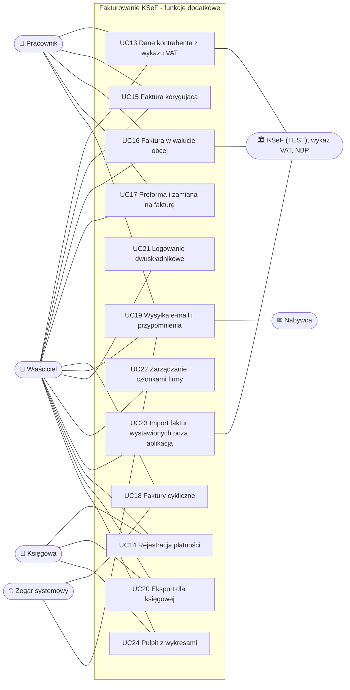

# Przypadki użycia

## Aktorzy

| Aktor | Opis |
|---|---|
| **Gość** | Osoba niezalogowana; może się zarejestrować lub zalogować. |
| **Użytkownik** | Zalogowany przedsiębiorca (właściciel firmy w aplikacji). W MVP 1 konto = 1 firma (D4); po MVP role w firmie - zob. [przypadki funkcji dodatkowych](#przypadki-użycia-funkcji-dodatkowych-po-mvp) (D46). |
| **KSeF** | Krajowy System e-Faktur (środowisko testowe) - system zewnętrzny: przyjmuje faktury, nadaje numery, wydaje UPO, udostępnia faktury otrzymane. |
| **Zegar systemowy** | Wyzwala cykliczne operacje w tle (odpytywanie o statusy, pobieranie faktur otrzymanych). |

## Diagram przypadków użycia

## Opisy przypadków użycia

### UC1 Rejestracja
- **Aktor:** Gość.
- **Scenariusz główny:**
  1. Gość podaje e-mail i hasło (dwukrotnie).
  2. System sprawdza unikalność e-maila i politykę haseł: min. 8 znaków, wielka i mała litera, cyfra, znak specjalny.
  3. System tworzy konto, loguje użytkownika i przechodzi do formularza danych firmy.
- **Scenariusze alternatywne:** e-mail zajęty albo hasło niezgodne z polityką. System pokazuje komunikaty po polsku.

### UC2 Logowanie / wylogowanie
- **Scenariusz główny:**
  1. Użytkownik podaje e-mail i hasło.
  2. System ustawia ciasteczko sesji (HttpOnly, 8 godzin z przedłużaniem).
  3. System przechodzi do strony docelowej (`returnUrl`, tylko adresy względne).
- **Alternatywy:**
  - błędne dane: komunikat „Nieprawidłowy e-mail lub hasło”,
  - 5 nieudanych prób: blokada konta na 15 minut,
  - próba wejścia na chronioną stronę bez sesji: przekierowanie do logowania.

### UC3 Zarządzanie danymi firmy
- **Scenariusz główny:**
  1. Użytkownik wypełnia nazwę, NIP, adres, e-mail, telefon i rachunek.
  2. System waliduje dane (NIP z sumą kontrolną, kod pocztowy `00-000`, rachunek), normalizuje je i zapisuje.
- **Uwagi:** dane są kopiowane na fakturę w chwili jej wysłania, więc późniejsza zmiana nie wpływa na faktury wysłane.

### UC4 Konfiguracja tokenu KSeF
- **Scenariusz główny A (docelowy):**
  1. Użytkownik wkleja token wygenerowany w Aplikacji Podatnika.
  2. System sprawdza token w KSeF, szyfruje go i zapisuje.
- **Scenariusz główny B (tylko środowisko testowe):**
  1. Użytkownik wybiera „Wygeneruj token testowy”.
  2. System loguje się do testowego KSeF certyfikatem testowym dla NIP firmy, generuje token z uprawnieniami
     do faktur i zapisuje go zaszyfrowanego.
- **Alternatywy:**
  - token odrzucony przez KSeF: komunikat, token nie jest zapisywany,
  - usunięcie tokenu.

### UC5 Zarządzanie kontrahentami
- **Scenariusz główny:** dodanie, edycja, wyszukiwanie po nazwie lub NIP, usunięcie kontrahenta. Kontrahent może
  być firmą (NIP wymagany) albo osobą prywatną.
- **Alternatywy:** duplikat NIP w obrębie firmy (komunikat), usunięcie kontrahenta (miękkie, wystawione faktury
  pozostają bez zmian).

### UC6 Wystawienie faktury
- **Warunek wstępny:** uzupełnione dane firmy.
- **Scenariusz główny:**
  1. Użytkownik wybiera kontrahenta z listy albo wpisuje nabywcę ręcznie.
  2. Dodaje pozycje (nazwa, j.m., ilość, cena netto, stawka VAT). System na bieżąco liczy wartości i podsumowanie
     według stawek VAT.
  3. Podaje daty i płatność, opcjonalnie numer. Pusty numer oznacza nadanie automatyczne `FV/n/MM/RRRR`.
  4. System waliduje fakturę, przelicza kwoty po stronie serwera i zapisuje szkic.
- **Alternatywy:**
  - pozycja ze stawką „zw” wymaga podstawy prawnej zwolnienia,
  - przelew wymaga terminu płatności,
  - duplikat numeru daje komunikat,
  - błędy pól są pokazywane przy właściwych polach.

### UC7 Edycja / usunięcie szkicu
- **Warunek:** faktura w statusie Szkic lub Odrzucona przez KSeF.
- **Scenariusz główny:** zmiana danych i zapis z kontrolą wersji albo usunięcie (miękkie) po potwierdzeniu.
- **Alternatywy:**
  - faktura zmieniona w międzyczasie, np. w innej karcie: komunikat o konflikcie,
  - faktura wysłana lub przyjęta: edycja i usunięcie niedostępne.

### UC8 Wysłanie faktury do KSeF
- **Warunki:** skonfigurowany token KSeF; faktura w statusie Szkic lub Odrzucona.
- **Scenariusz główny:**
  1. Użytkownik wybiera „Wyślij do KSeF” i potwierdza.
  2. System utrwala dane sprzedawcy, generuje XML FA(3), waliduje go względem schematu, zapisuje dokument
     i jego skrót. Status zmienia się na „Wysłana do KSeF”.
  3. Usługa w tle wysyła fakturę i odpytuje KSeF o status.
  4. KSeF nadaje numer. System zapisuje numer KSeF (status „Przyjęta w KSeF”), zamyka sesję i pobiera UPO.
  5. Strona odświeża status automatycznie.
- **Alternatywy:**
  - KSeF odrzuca fakturę: status „Odrzucona” z kodem i szczegółami błędów; użytkownik poprawia fakturę i wysyła ponownie,
  - awaria komunikacji przed przyjęciem faktury przez KSeF: ponawianie, po 10 próbach przerwanie,
  - awaria po przyjęciu faktury do przetwarzania: wyłącznie ponawianie odpytania o status, bez ryzyka duplikatu,
  - podwójne kliknięcie: tylko jedna wysyłka.

### UC9 Przeglądanie i wyszukiwanie faktur
- **Scenariusz główny:** lista faktur z filtrami (status, zakres dat, tekst: numer, nabywca, NIP, numer KSeF),
  stronicowaniem i filtrami zapisanymi w adresie strony; pulpit z liczbą faktur w każdym statusie.

### UC10 Pobranie UPO, XML, PDF
- **Scenariusz główny:** użytkownik pobiera z podglądu faktury:
  - UPO: urzędowe poświadczenie odbioru, dla faktur przyjętych,
  - XML w strukturze FA(3): dla faktur wysłanych dokładnie wysłany dokument,
  - PDF: dla faktur w KSeF z kodem QR weryfikacji i numerem KSeF; szkic jest oznaczony jako niebędący fakturą.

### UC11 Pobranie faktur otrzymanych
- **Wyzwalacz:** użytkownik („Pobierz z KSeF”, nie częściej niż raz na minutę) albo zegar systemowy (co 15 minut).
- **Scenariusz główny:**
  1. System pyta KSeF o faktury wystawione na NIP firmy od ostatniego punktu kontrolnego do HWM.
  2. Pobiera XML nowych faktur i zapisuje je.
  3. Przesuwa punkt kontrolny.
- **Alternatywy:**
  - brak nowych faktur: komunikat,
  - wyczerpany limit zapytań: pozostałe faktury pobiera kolejny przebieg,
  - błąd KSeF: komunikat i ponowienie w kolejnym przebiegu.

### UC12 Przeglądanie faktur otrzymanych
- **Scenariusz główny:** lista z wyszukiwaniem, podgląd treści odczytanej z XML (sprzedawca, pozycje,
  podsumowanie VAT, płatność), pobranie XML i PDF z kodem QR.

## Przypadki użycia funkcji dodatkowych (po MVP)

Po MVP model aktorów rozszerzono o role w firmie (D46). Przypadki UC1-UC12 wykonuje **właściciel**; pracownik i księgowa
wykonują je w zakresie swojej roli (tabela uprawnień poniżej).

| Aktor | Opis |
|---|---|
| **Właściciel** | Użytkownik, który utworzył firmę; pełne uprawnienia, zarządza członkami firmy. |
| **Pracownik** | Członek firmy: wystawia i wysyła faktury, prowadzi kontrahentów i katalog; nie zmienia ustawień firmy. |
| **Księgowa** | Członek firmy: odczyt faktur i danych, eksporty, rejestrowanie płatności; nie wystawia faktur. |
| **Nabywca (odbiorca e-mail)** | Osoba spoza systemu, otrzymuje fakturę i przypomnienia e-mailem. |
| **Wykaz VAT MF, NBP** | Systemy zewnętrzne: dane kontrahenta i rachunki (wykaz podatników VAT), kursy walut (NBP). |

### Uprawnienia ról

| Działanie | Właściciel | Pracownik | Księgowa |
|---|:-:|:-:|:-:|
| Przeglądanie faktur, kontrahentów, faktur otrzymanych, pobieranie PDF/XML/UPO | ✅ | ✅ | ✅ |
| Wystawianie, edycja, wysyłka do KSeF, korekty, kontrahenci, katalog | ✅ | ✅ | - |
| Rejestrowanie płatności, eksport dla księgowej | ✅ | ✅ | ✅ |
| Dane firmy, token KSeF, ustawienia e-mail i przypomnień, członkowie firmy | ✅ | - | - |

Szczegółowe reguły: D46 i `api.md` (filtry ról na endpointach).

### UC13 Dane kontrahenta z wykazu VAT
- **Scenariusz główny:** użytkownik wpisuje NIP i wybiera „Pobierz z wykazu VAT”; system pobiera nazwę, adres
  i rachunki z wykazu podatników VAT MF (z pamięci podręcznej, jeśli dane są świeże) i wypełnia formularz.
- **Alternatywy:** NIP nieobecny w wykazie; przekroczony dzienny limit zapytań lub usługa niedostępna - komunikat,
  dane wpisuje się ręcznie (D28). Dla faktury otrzymanej system sprawdza, czy rachunek sprzedawcy jest na białej liście (D29).

### UC14 Rejestracja płatności
- **Scenariusz główny:** użytkownik dodaje wpłatę (data, kwota) do faktury wystawionej lub otrzymanej; system wylicza
  status: nieopłacona, częściowo opłacona, opłacona, po terminie (D30). Płatność można usunąć.
- **Alternatywy:** kwota większa niż pozostała do zapłaty - komunikat; faktura opłacona przy wystawieniu („Zapłacono”, D33)
  ma płatność od razu.

### UC15 Faktura korygująca
- **Warunek:** faktura przyjęta w KSeF.
- **Scenariusz główny:** użytkownik wybiera „Wystaw korektę”, podaje przyczynę i zmienia pozycje (stan „przed i po”);
  system liczy różnice i wystawia korektę FA(3) z numerem KSeF korygowanej faktury, wysyłaną jak UC8 (D32).

### UC16 Faktura w walucie obcej
- **Scenariusz główny:** użytkownik wybiera walutę; przy zapisie serwer pobiera kurs średni NBP z ostatniego dnia
  roboczego przed dniem sprzedaży i przelicza VAT na złote (D43).
- **Alternatywy:** NBP niedostępne - zapis faktury walutowej zablokowany czytelnym komunikatem (bez zgadywania kursu);
  zmiana daty sprzedaży w szkicu pobiera kurs ponownie.

### UC17 Proforma i zamiana na fakturę
- **Scenariusz główny:** użytkownik wystawia proformę (dokument poza KSeF, numeracja `PRO/n/MM/RRRR`, PDF z oznaczeniem,
  że nie jest fakturą VAT; można ją wysłać e-mailem); następnie wybiera „Wystaw fakturę VAT” - system tworzy szkic faktury
  z aktualnymi danymi nabywcy i pozycjami proformy i łączy oba dokumenty (D42).
- **Alternatywy:** proformę można zamienić tylko raz; nie można jej wysłać do KSeF ani oznaczyć jako zapłaconej.

### UC18 Faktury cykliczne
- **Scenariusz główny:** użytkownik tworzy harmonogram z faktury-wzoru (co 1, 3, 6 lub 12 miesięcy, data najbliższego
  wystawienia, opcjonalnie data końcowa);
  zegar systemowy tworzy w terminie szkic faktury i opcjonalnie powiadamia e-mailem; użytkownik sprawdza i wysyła szkic (D39).
- **Alternatywy:** wstrzymanie i wznowienie harmonogramu; po przestoju aplikacji powstaje jeden szkic (bez zaległej lawiny).

### UC19 Wysyłka e-mail i przypomnienia
- **Scenariusz główny:** użytkownik wysyła fakturę e-mailem (PDF i XML w załącznikach); wiadomość trafia do kolejki
  i jest wysyłana w tle (D36). Przypomnienie o płatności wysyła użytkownik albo zegar systemowy - pierwsze po ustawionej liczbie
  dni po terminie, kolejne nie częściej niż co 7 dni, najwyżej 3 do faktury; po wpłacie przypomnienia ustają (D37).
- **Alternatywy:** brak skonfigurowanej poczty - funkcja niedostępna; dzienny limit wiadomości firmy; błąd SMTP -
  ponawianie z rosnącym odstępem.

### UC20 Eksport dla księgowej
- **Scenariusz główny:** użytkownik wybiera okres; system pokazuje podsumowanie i udostępnia zestawienia CSV faktur
  sprzedaży i zakupu oraz paczkę ZIP z dokumentami XML i UPO (D34).
- **Alternatywy:** okres dłuższy niż 366 dni - komunikat.

### UC21 Logowanie dwuskładnikowe
- **Scenariusz główny:** użytkownik włącza 2FA: skanuje kod QR aplikacją uwierzytelniającą, potwierdza kodem, zapisuje
  kody odzyskiwania. Przy logowaniu po haśle podaje kod z aplikacji lub kod odzyskiwania (D41).
- **Alternatywy:** błędny kod - komunikat, pozostaje krok kodu; wyłączenie 2FA wymaga podania aktualnego kodu.

### UC22 Zarządzanie członkami firmy
- **Scenariusz główny:** właściciel zaprasza osobę (e-mail, rola); system wysyła link ważny 7 dni. Zaproszony zakłada
  konto lub loguje się na ten sam adres i przyjmuje zaproszenie. Właściciel zmienia rolę lub odbiera dostęp (D46).
- **Alternatywy:** link wygasły lub wykorzystany; inny adres e-mail niż w zaproszeniu - odmowa; osoba z dostępem
  do kilku firm przełącza firmę w górnym pasku.

### UC23 Import faktur wystawionych poza aplikacją
- **Scenariusz główny:** podczas synchronizacji (UC11) system pobiera z KSeF także faktury sprzedaży wystawione na NIP
  firmy w innym programie i pokazuje je na liście jako zaimportowane (tylko do odczytu, z płatnościami i PDF) (D44).

### UC24 Pulpit z wykresami
- **Scenariusz główny:** użytkownik widzi sprzedaż i koszty netto w 12 ostatnich miesiącach, wiekowanie należności
  i pięciu największych nabywców; wartości są też w tabeli pod wykresem (dostępność) (D40, waluty - D43).
