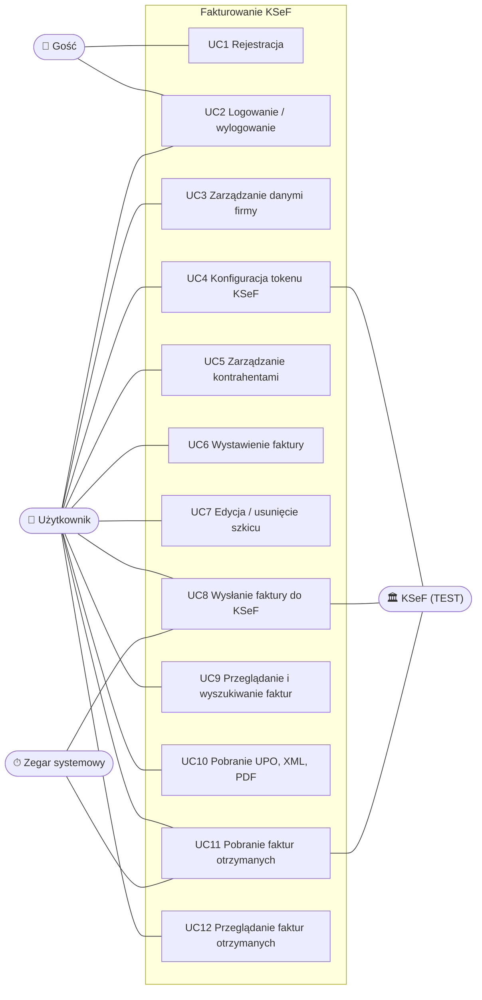

# Przypadki użycia

## Aktorzy

| Aktor | Opis |
|---|---|
| **Gość** | Osoba niezalogowana; może się zarejestrować lub zalogować. |
| **Użytkownik** | Zalogowany przedsiębiorca (właściciel firmy w aplikacji); 1 konto = 1 firma (D4). |
| **KSeF** | Krajowy System e-Faktur (środowisko testowe) - system zewnętrzny: przyjmuje faktury, nadaje numery, wydaje UPO, udostępnia faktury otrzymane. |
| **Zegar systemowy** | Wyzwala cykliczne operacje w tle (odpytywanie o statusy, pobieranie faktur otrzymanych). |

## Diagram przypadków użycia

## Opisy przypadków użycia

### UC1 Rejestracja
- **Aktor:** Gość.
- **Scenariusz główny:**
  1. Gość podaje e-mail i hasło (dwukrotnie).
  2. System sprawdza unikalność e-maila i politykę haseł: min. 8 znaków, wielka i mała litera, cyfra, znak specjalny.
  3. System tworzy konto, loguje użytkownika i przechodzi do formularza danych firmy.
- **Scenariusze alternatywne:** e-mail zajęty albo hasło niezgodne z polityką. System pokazuje komunikaty po polsku.

### UC2 Logowanie / wylogowanie
- **Scenariusz główny:**
  1. Użytkownik podaje e-mail i hasło.
  2. System ustawia ciasteczko sesji (HttpOnly, 8 godzin z przedłużaniem).
  3. System przechodzi do strony docelowej (`returnUrl`, tylko adresy względne).
- **Alternatywy:**
  - błędne dane: komunikat „Nieprawidłowy e-mail lub hasło”,
  - 5 nieudanych prób: blokada konta na 15 minut,
  - próba wejścia na chronioną stronę bez sesji: przekierowanie do logowania.

### UC3 Zarządzanie danymi firmy
- **Scenariusz główny:**
  1. Użytkownik wypełnia nazwę, NIP, adres, e-mail, telefon i rachunek.
  2. System waliduje dane (NIP z sumą kontrolną, kod pocztowy `00-000`, rachunek), normalizuje je i zapisuje.
- **Uwagi:** dane są kopiowane na fakturę w chwili jej wysłania, więc późniejsza zmiana nie wpływa na faktury wysłane.

### UC4 Konfiguracja tokenu KSeF
- **Scenariusz główny A (docelowy):**
  1. Użytkownik wkleja token wygenerowany w Aplikacji Podatnika.
  2. System sprawdza token w KSeF, szyfruje go i zapisuje.
- **Scenariusz główny B (tylko środowisko testowe):**
  1. Użytkownik wybiera „Wygeneruj token testowy”.
  2. System loguje się do testowego KSeF certyfikatem testowym dla NIP firmy, generuje token z uprawnieniami
     do faktur i zapisuje go zaszyfrowanego.
- **Alternatywy:**
  - token odrzucony przez KSeF: komunikat, token nie jest zapisywany,
  - usunięcie tokenu.

### UC5 Zarządzanie kontrahentami
- **Scenariusz główny:** dodanie, edycja, wyszukiwanie po nazwie lub NIP, usunięcie kontrahenta. Kontrahent może
  być firmą (NIP wymagany) albo osobą prywatną.
- **Alternatywy:** duplikat NIP w obrębie firmy (komunikat), usunięcie kontrahenta (miękkie, wystawione faktury
  pozostają bez zmian).

### UC6 Wystawienie faktury
- **Warunek wstępny:** uzupełnione dane firmy.
- **Scenariusz główny:**
  1. Użytkownik wybiera kontrahenta z listy albo wpisuje nabywcę ręcznie.
  2. Dodaje pozycje (nazwa, j.m., ilość, cena netto, stawka VAT). System na bieżąco liczy wartości i podsumowanie
     według stawek VAT.
  3. Podaje daty i płatność, opcjonalnie numer. Pusty numer oznacza nadanie automatyczne `FV/n/MM/RRRR`.
  4. System waliduje fakturę, przelicza kwoty po stronie serwera i zapisuje szkic.
- **Alternatywy:**
  - pozycja ze stawką „zw” wymaga podstawy prawnej zwolnienia,
  - przelew wymaga terminu płatności,
  - duplikat numeru daje komunikat,
  - błędy pól są pokazywane przy właściwych polach.

### UC7 Edycja / usunięcie szkicu
- **Warunek:** faktura w statusie Szkic lub Odrzucona przez KSeF.
- **Scenariusz główny:** zmiana danych i zapis z kontrolą wersji albo usunięcie (miękkie) po potwierdzeniu.
- **Alternatywy:**
  - faktura zmieniona w międzyczasie, np. w innej karcie: komunikat o konflikcie,
  - faktura wysłana lub przyjęta: edycja i usunięcie niedostępne.

### UC8 Wysłanie faktury do KSeF
- **Warunki:** skonfigurowany token KSeF; faktura w statusie Szkic lub Odrzucona.
- **Scenariusz główny:**
  1. Użytkownik wybiera „Wyślij do KSeF” i potwierdza.
  2. System utrwala dane sprzedawcy, generuje XML FA(3), waliduje go względem schematu, zapisuje dokument
     i jego skrót. Status zmienia się na „Wysłana do KSeF”.
  3. Usługa w tle wysyła fakturę i odpytuje KSeF o status.
  4. KSeF nadaje numer. System zapisuje numer KSeF (status „Przyjęta w KSeF”), zamyka sesję i pobiera UPO.
  5. Strona odświeża status automatycznie.
- **Alternatywy:**
  - KSeF odrzuca fakturę: status „Odrzucona” z kodem i szczegółami błędów; użytkownik poprawia fakturę i wysyła ponownie,
  - awaria komunikacji przed przyjęciem faktury przez KSeF: ponawianie, po 10 próbach przerwanie,
  - awaria po przyjęciu faktury do przetwarzania: wyłącznie ponawianie odpytania o status, bez ryzyka duplikatu,
  - podwójne kliknięcie: tylko jedna wysyłka.

### UC9 Przeglądanie i wyszukiwanie faktur
- **Scenariusz główny:** lista faktur z filtrami (status, zakres dat, tekst: numer, nabywca, NIP, numer KSeF),
  stronicowaniem i filtrami zapisanymi w adresie strony; pulpit z liczbą faktur w każdym statusie.

### UC10 Pobranie UPO, XML, PDF
- **Scenariusz główny:** użytkownik pobiera z podglądu faktury:
  - UPO: urzędowe poświadczenie odbioru, dla faktur przyjętych,
  - XML w strukturze FA(3): dla faktur wysłanych dokładnie wysłany dokument,
  - PDF: dla faktur w KSeF z kodem QR weryfikacji i numerem KSeF; szkic jest oznaczony jako niebędący fakturą.

### UC11 Pobranie faktur otrzymanych
- **Wyzwalacz:** użytkownik („Pobierz z KSeF”, nie częściej niż raz na minutę) albo zegar systemowy (co 15 minut).
- **Scenariusz główny:**
  1. System pyta KSeF o faktury wystawione na NIP firmy od ostatniego punktu kontrolnego do HWM.
  2. Pobiera XML nowych faktur i zapisuje je.
  3. Przesuwa punkt kontrolny.
- **Alternatywy:**
  - brak nowych faktur: komunikat,
  - wyczerpany limit zapytań: pozostałe faktury pobiera kolejny przebieg,
  - błąd KSeF: komunikat i ponowienie w kolejnym przebiegu.

### UC12 Przeglądanie faktur otrzymanych
- **Scenariusz główny:** lista z wyszukiwaniem, podgląd treści odczytanej z XML (sprzedawca, pozycje,
  podsumowanie VAT, płatność), pobranie XML i PDF z kodem QR.
