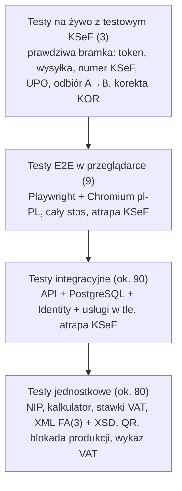

# Testowanie

## Strategia

Testy obejmują wszystkie warstwy: logikę (testy jednostkowe), API z prawdziwą bazą (testy integracyjne),
interfejs w prawdziwej przeglądarce (E2E) oraz integrację z prawdziwym testowym KSeF (testy na żywo).
Strategię uzasadnia decyzja D7.

| Rodzaj | Narzędzia | Uruchamianie | W CI |
|---|---|---|---|
| Jednostkowe | xUnit | `dotnet test` | tak |
| Integracyjne | xUnit, `WebApplicationFactory`, PostgreSQL (tymczasowa baza `ksef_test_*` na każdą klasę testów) | `dotnet test` (wymaga PostgreSQL) | tak (usługa PostgreSQL) |
| E2E | Microsoft.Playwright, Chromium (`pl-PL`), aplikacja na Kestrel | `E2E_TESTS=1 dotnet test` | tak |
| Na żywo z testowym KSeF | prawdziwa bramka + `api-test.ksef.mf.gov.pl` | `KSEF_LIVE_TESTS=1 dotnet test --filter KsefLiveTests` | nie (wymaga dostępu do KSeF) |

Łącznie **190 przypadków testowych**. CI w GitHub Actions uruchamia przy każdym wypchnięciu zmian testy
jednostkowe, integracyjne i E2E.

## Zakres

| Obszar | Klasy testów | Co sprawdzają |
|---|---|---|
| Walidacja i obliczenia | `NipValidatorTests`, `InvoiceCalculatorTests`, `VatRateTests`, `ValidationCultureTests` | NIP z sumą kontrolną; zaokrąglenia; VAT od sumy netto w stawce; zgodność stawek z XSD; walidacja w kulturach pl-PL/en-US/de-DE |
| Model danych | `DataModelTests` | znaczniki czasu, miękkie usuwanie, unikalność, `RESTRICT`, niezmienność kopii danych na fakturze, precyzja FA(3), konflikt wersji |
| API i uwierzytelnianie | `AuthTests`, `CookieAuthTests`, `CompanyApiTests`, `CustomerApiTests`, `InvoiceApiTests`, `HostingTests` | rejestracja i logowanie, flagi ciasteczka, walidacja, numeracja, statusy, kontrola wersji, filtrowanie, serwowanie klienta |
| Izolacja danych | `DataIsolationTests` i testy izolacji w klasach KSeF, PDF i faktur otrzymanych | brak dostępu do danych innego użytkownika (odczyt, lista, zmiana, usunięcie, wysyłka, UPO, XML, PDF) |
| XML FA(3) | `Fa3XmlGeneratorTests`, `Fa3SchemaValidatorTests`, `InvoiceXmlApiTests`, `Fa3InvoiceReaderTests` | każdy wariant faktury zgodny z oficjalnym XSD; UTF-8 bez BOM; znaki specjalne; ochrona przed XXE; odczyt faktur MF |
| Integracja z KSeF | `KsefSettingsTests`, `KsefSendingTests`, `ReceivedInvoicesTests`, `KsefEnvironmentGuardTests`, `KsefClientRegistrationTests` | szyfrowanie tokenu; pełny przepływ wysyłki; odrzucenie i ponowna wysyłka; awarie przed i po wysyłce; podwójna wysyłka; synchronizacja do HWM, limity, deduplikacja; blokada produkcji |
| PDF i QR | `InvoicePdfTests`, `KsefQrTests` | treść PDF odczytana z pliku (PdfPig); zgodność linku QR z klientem MF |
| Faktury korygujące | `CorrectionCalculatorTests`, `CorrectionXmlTests`, `CorrectionApiTests` | różnica per stawka; XML KOR zgodny z XSD (obniżka, korekta do zera, dopłata), odczyt KOR; tworzenie, numeracja, wysyłka, kolejna korekta, blokada przy korekcie w toku, reguły, PDF, rozliczenie po korekcie, izolacja |
| Rozliczenia | `PaymentRulesTests`, `PaymentApiTests` | stan rozliczenia i zaległości; wpłaty częściowe i pełne; nadpłata, data z przyszłości, szkic; filtry list; podsumowanie należności i zobowiązań; zapłata oznaczona w fakturze (XML, płatność przy wysyłce, brak duplikatu po odrzuceniu, blokada usunięcia); izolacja |
| Wykaz podatników VAT | `WhiteListAddressTests`, `VatWhiteListClientTests`, `VatRegistryApiTests`, `VatRegistryLimitTests`, testy rachunku w `ReceivedInvoicesTests` | rozbiór adresu z wykazu; odczyt odpowiedzi i błędów API MF (wyszukiwanie, sprawdzenie rachunku); pamięć podręczna; limity dzienne; awaria MF; zapis wyniku sprawdzenia, rachunki zagraniczne, izolacja |
| Interfejs (E2E) | `UserScenariosE2ETests` | główne scenariusze użytkownika i regresje błędów interfejsu |
| Na żywo | `KsefLiveTests` | prawdziwy testowy KSeF: wysyłka, numer KSeF, UPO; faktura firmy A odebrana przez firmę B; faktura korygująca przyjęta przez KSeF; faktura oznaczona jako zapłacona przyjęta przez KSeF |

## Atrapa KSeF

`FakeKsefGateway` implementuje `IKsefGateway` bez sieci. Pozwala symulować przyjęcie, przetwarzanie i odrzucenie
faktury, awarie komunikacji, faktury otrzymane i HWM. Dzięki temu CI sprawdza wszystkie ścieżki, w tym te,
których nie da się łatwo wywołać na prawdziwym KSeF, np. awarię sieci dokładnie po przyjęciu faktury.

Analogicznie `FakeVatWhiteList` zastępuje API wykazu podatników VAT (podmioty, awaria, licznik zapytań do MF).

**Zrzuty ekranu do dokumentacji** powstają w testach E2E: `E2E_SCREENSHOTS_DIR=docs/zrzuty` zapisuje je
w trakcie scenariuszy (bez tej zmiennej testy nie robią zrzutów).

## Błędy wykryte przez testy

| Błąd | Wykryty przez | Opis | Poprawka |
|---|---|---|---|
| Brak middleware autoryzacji | testy integracyjne (etap 0) | endpointy wymagające logowania zwracały 500 | dodanie `UseAuthorization` |
| Testy usuwały bazę deweloperską | obserwacja podczas testów (etap 0) | konfiguracja odczytywana przy starcie, przed nadpisaniem przez testy | leniwy odczyt konfiguracji i bezpiecznik: usuwanie tylko baz `ksef_test_*` |
| Walidacja ilości w kulturze pl-PL (D20) | test E2E w przeglądarce (etap 4) | `[Range]` parsował granice według kultury, w przeglądarce rzucał wyjątek | parsowanie niezależne od kultury i test regresyjny |
| „Nieklikalny” przycisk Zapisz (D22) | test E2E w przeglądarce (etap 5) | komunikat błędu znikał w chwili kliknięcia i przesuwał przycisk | walidacja podczas pisania (`InputTextLive`) |
| Numer KSeF atrapy niezgodny z formatem KSeF | walidacja XSD korekty (funkcja „Faktury korygujące”) | atrapa nadawała numery `…-FAKTURA-1-00`, a XML korekty zawiera numer faktury korygowanej (typ `TNumerKSeF`) | atrapa nadaje numery w formacie prawdziwego KSeF |
| Zawijanie numeru KSeF pod kodem QR | test treści PDF (etap 8) | numer KSeF dzielony na dwie linie | szersza kolumna oznaczenia |

Wniosek: testy API nie wystarczają. Dwa z błędów (D20, D22) były widoczne wyłącznie w prawdziwej przeglądarce,
co uzasadnia automatyczne testy E2E w CI.

## Wyniki testów na żywo (testowy KSeF, 1.11.2026)

| Scenariusz | Wynik |
|---|---|
| Wysyłka faktury z generatora aplikacji | przyjęta, numer KSeF i UPO w ok. 7 s |
| Wysyłka z aplikacji (przeglądarka, usługa w tle) | numer KSeF i UPO ok. 10 s od kliknięcia „Wyślij” |
| Zgodność skrótu dokumentu (kod QR) z UPO | identyczny dla wszystkich sprawdzonych faktur |
| Odbiór faktury firmy A przez firmę B | faktura dostępna do pobrania ok. 2 minuty po nadaniu numeru KSeF |
| Faktura korygująca (KOR) do faktury przyjętej w KSeF | przyjęta, numer KSeF; cały test (faktura + korekta) ok. 9 s |
| Faktura oznaczona jako zapłacona (`Zaplacono`, `DataZaplaty`), 5.11.2026 | przyjęta, numer KSeF; ok. 6 s |
