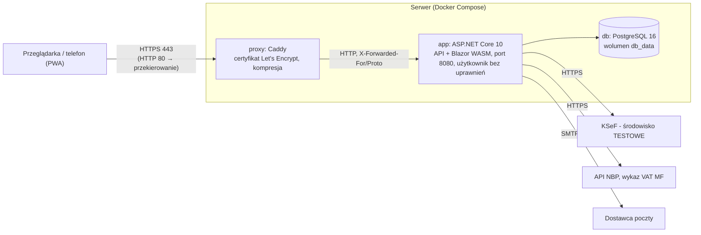

# Wdrożenie

Aplikacja jest przygotowana do wdrożenia na serwerze (VPS) w kontenerach Docker: baza PostgreSQL, aplikacja
(API + klient Blazor WebAssembly) i odwrotne proxy Caddy z automatycznym certyfikatem HTTPS. Decyzja: D48.
Konfiguracja została uruchomiona i sprawdzona lokalnie w kontenerach; faktyczne wdrożenie na serwer jest
odłożone na prośbę autora.

> Niezależnie od konfiguracji aplikacja łączy się **wyłącznie z testowym środowiskiem KSeF** (D8) - faktury nie mają
> mocy prawnej. Przełączenie na produkcyjny KSeF wymagałoby świadomej zmiany kodu (`KsefEnvironment`, `KsefTestOnlyHandler`).

## Architektura wdrożenia



Do internetu wystawione są tylko porty 80 i 443 proxy. Aplikacja i baza nie mają opublikowanych portów - są dostępne
wyłącznie w wewnętrznej sieci kontenerów.

## Pliki

| Plik | Rola |
|---|---|
| `Dockerfile` | Obraz aplikacji: budowanie w obrazie SDK (.NET 10), uruchomienie w obrazie ASP.NET jako użytkownik `app` (bez uprawnień administratora); `HEALTHCHECK` na `/api/health` |
| `.dockerignore` | Kontekst budowania bez wyników kompilacji, testów, dokumentacji i sekretów |
| `deploy/docker-compose.prod.yml` | Baza, aplikacja, proxy; konfiguracja ze zmiennych środowiskowych |
| `deploy/Caddyfile` | Proxy dla domeny z `DOMAIN`: certyfikat HTTPS, przekierowanie HTTP → HTTPS |
| `deploy/.env.example` | Wzór pliku `.env` z sekretami (plik `.env` nie trafia do repozytorium) |
| `deploy/backup-db.sh` | Kopia zapasowa bazy (`pg_dump`, rotacja 14 dni) |
| `deploy/secrets/` | Miejsce na certyfikat Data Protection (ignorowane przez git) |

## Wymagania

- serwer z Linuksem (np. 2 vCPU, 2-4 GB RAM), Docker z wtyczką Compose,
- domena z rekordem DNS (A/AAAA) wskazującym na serwer; otwarte porty 80 i 443 (Let's Encrypt),
- opcjonalnie: konto u dostawcy poczty transakcyjnej (SMTP) - bez niego funkcje e-mail są wyłączone.

## Krok po kroku

```bash
git clone --recursive <adres-repozytorium> /opt/fakturowanie
cd /opt/fakturowanie/deploy
cp .env.example .env
# uzupełnij .env: DOMAIN, DB_PASSWORD (np. openssl rand -base64 32), opcjonalnie SMTP_*

# certyfikat chroniący klucze szyfrowania tokenów KSeF (zalecane)
openssl req -x509 -newkey rsa:3072 -days 3650 -nodes -subj "/CN=fakturowanie-dataprotection" \
  -keyout secrets/dp.key -out secrets/dp.crt
openssl pkcs12 -export -inkey secrets/dp.key -in secrets/dp.crt -out secrets/dataprotection.pfx -passout pass:<hasło>
rm secrets/dp.key secrets/dp.crt
# w .env: DP_CERT_PATH=/run/secrets/app/dataprotection.pfx, DP_CERT_PASSWORD=<hasło>

docker compose -f docker-compose.prod.yml --env-file .env up -d --build
docker compose -f docker-compose.prod.yml ps        # app: healthy
curl https://$DOMAIN/api/health                       # Healthy
```

Przy pierwszym starcie aplikacja wykonuje migracje bazy (`Database__MigrateOnStartup`), a Caddy uzyskuje certyfikat.

## Konfiguracja produkcyjna aplikacji

| Ustawienie (zmienna środowiskowa) | Znaczenie |
|---|---|
| `ASPNETCORE_ENVIRONMENT=Production` | Brak Swaggera i szczegółów błędów; ciasteczka tylko przez HTTPS (`Secure`); nagłówek HSTS (365 dni, bez subdomen) |
| `ConnectionStrings__DefaultConnection` | Połączenie z bazą - **aplikacja odmawia startu z hasłem deweloperskim z repozytorium** |
| `Database__MigrateOnStartup=true` | Migracje przy starcie (z ponawianiem, gdy baza jeszcze startuje) |
| `ReverseProxy__Enabled=true` | Adres klienta i schemat HTTPS z nagłówków `X-Forwarded-*` (limity żądań, ciasteczka `Secure`); przekierowanie na HTTPS robi proxy |
| `AllowedHosts` | Domena aplikacji i `localhost` (filtrowanie nagłówka `Host`; `localhost` - kontrola stanu kontenera `HEALTHCHECK`, z zewnątrz aplikacja jest dostępna tylko przez proxy) |
| `App__PublicUrl` | Adres aplikacji w wiadomościach e-mail (zaproszenia, powiadomienia) |
| `Email__*` | Serwer SMTP; hasło tylko w `.env` |
| `DataProtection__CertificatePath`, `…Password` | Certyfikat szyfrujący klucze Data Protection w bazie - kopia bazy bez certyfikatu nie pozwala odszyfrować tokenów KSeF |
| `RateLimiting__*` | Limity żądań (domyślnie: logowanie, rejestracja, reset hasła 30/min z adresu, logowanie 10/min na parę adres + e-mail, operacje z kodem 2FA 5/min na użytkownika, API 600/min na użytkownika - D47, D52) |

## Kopie zapasowe i odtwarzanie

```bash
# codziennie o 2:15 (crontab -e)
15 2 * * * /opt/fakturowanie/deploy/backup-db.sh >> /var/log/fakturowanie-backup.log 2>&1

# odtworzenie
gunzip -c backups/ksef-<data>.sql.gz | docker compose -f docker-compose.prod.yml --env-file .env exec -T db psql -U ksef -d ksef
```

Kopię bazy należy przechowywać także poza serwerem. Do odtworzenia tokenów KSeF potrzebny jest również certyfikat
z `deploy/secrets/` - przechowywany oddzielnie od kopii bazy.

## Aktualizacja i monitorowanie

- aktualizacja: `git pull && git submodule update && docker compose -f docker-compose.prod.yml --env-file .env up -d --build`
  (migracje wykonają się przy starcie; po aktualizacji service worker PWA pobierze nową wersję aplikacji),
- stan: `GET /api/health` (także `HEALTHCHECK` kontenera), logi: `docker compose ... logs -f app proxy`,
- odnowienie certyfikatu HTTPS: automatycznie (Caddy).

## Lista kontrolna przed uruchomieniem

- [ ] `DB_PASSWORD` długie i losowe; `.env` z uprawnieniami 600; certyfikat Data Protection w `deploy/secrets/`
- [ ] domena i DNS; porty 80/443 otwarte, pozostałe zamknięte (zapora)
- [ ] SMTP z poprawnymi rekordami SPF/DKIM domeny nadawcy (`EMAIL_FROM`)
- [ ] **wykaz podatników VAT z adresu serwera**: zapytania z adresów centrów danych bywają blokowane przez zabezpieczenie
      MF przed botami (D43) - sprawdzić „Pobierz z wykazu VAT”; w razie blokady dane wpisuje się ręcznie
- [ ] kopie zapasowe w cronie i test odtworzenia
- [ ] ostrzeżenie o testowym KSeF widoczne w aplikacji (D24) - użytkownicy nie wysyłają danych prawdziwych firm

## Weryfikacja (7.11.2026)

Opublikowana aplikacja uruchomiona w obrazie z `Dockerfile` (etap uruchomieniowy) razem z `deploy/docker-compose.prod.yml`
i domeną `localhost` (certyfikat z lokalnego urzędu Caddy):

| Sprawdzenie | Wynik |
|---|---|
| Start: migracje bazy, kontrola stanu kontenera | wykonane, `healthy` |
| `http://` → `https://` | 308 (Caddy) |
| Nagłówki CSP, `X-Frame-Options` przez proxy | obecne |
| Rejestracja, logowanie ciasteczkiem, utworzenie firmy i faktury | 200/201; ciasteczko `Secure`, `HttpOnly` |
| PDF faktury w kontenerze (biblioteka natywna QuestPDF) | `application/pdf` |
| Start z hasłem deweloperskim do bazy | odmowa startu z komunikatem |
| Pełne budowanie obrazu (etap SDK) | w CI (zadanie `docker-image`) - w środowisku deweloperskim autora proxy sieciowe blokowało pobieranie pakietów w kontenerze |

Nagłówek HSTS nie jest wysyłany dla `localhost` (domyślne wyłączenie w ASP.NET Core) - dla prawdziwej domeny jest obecny.
